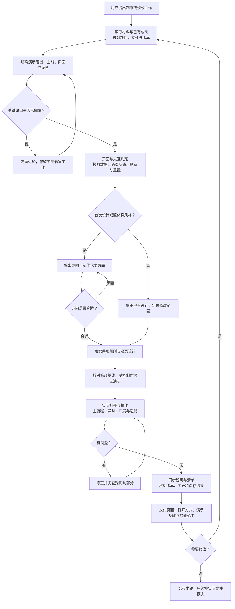

# UI 模块首版建设方案

编写日期：2026-11-02（Asia/Shanghai）。

文档状态：建设方案；步骤 1、2 已完成各自范围自查，证据见第 2.6、2.7 节。步骤 3 已有 Cursor 对话工作台代表页面候选，反馈、修订、完整实测与必要后续界面待补，见第 2.8 节；按用户决定不阻塞步骤 4。步骤 4 的工具实施说明与详细测试清单已建立并完成文档级自查，见第 2.9 节。步骤 5 实现、开发自验和门 2 独立验收已通过；Bowen 决定先受控使用，第 6—9 步后补，完整客户端链路仍未验证。

本文维护 UI 模块的建设目标、来源、职责、产物、拟建契约、实施顺序和验收范围。以后角色日常工作读取自己的主文档与适用方法，不要求每轮加载完整建设历史。已确认方向、本文新增的工程设计建议、已有代码和实际验收分别记录。

## 1. 建设目标与已确认方向

### 1.1 首版用户结果

根据用户已有需求、方案、页面说明或参考界面，直接制作一套设计一致、主流程可操作、可以重复展示的 UI 演示；支持多轮修改，并能够在新会话中依据实际文件继续。

UI 模块交付设计说明、实际页面、打开方式、演示步骤、模拟边界和实际验证范围。它既能独立结束，也能为未来工程开发提供可读取的材料。

首版围绕独立演示建设。这里的“独立”指具有自己的成果位置与运行入口，仍可以包含多个页面、共用组件、真实前端代码和完整的模拟交互。

### 1.2 本轮用户已认可的默认做法

用户先明确“期望 UI 模块首版能够直接做出可操作的演示页面”，随后对七项讨论回复“可以全部采取你的建议”。以下据此固化为产品方向，不把后文新提出的接口、目录和事务细节扩大为用户已确认决定。

| 编号 | 已认可方向 | 具体含义 |
| --- | --- | --- |
| D-01 | 制作可操作演示并实际检查 | 首版包含设计、页面制作与检查，不能只交设计文档 |
| D-02 | 围绕本次演示主线确定完整度 | 覆盖必要页面、相关校验、空数据、失败与恢复，不默认做完整产品 |
| D-03 | 首次设计或整体换风格时先看代表页面 | 根据参考与用户任务提出方向，调整合适后再展开其他页面；简单单页可以直接完成 |
| D-04 | 先明确约定，再边制作边完善文档 | 不先写大量与实际效果脱节的设计正文；交付前同步文档与页面 |
| D-05 | 模拟数据服务真实展示 | 数据符合业务语境、跨页状态一致、能够重置；是否持久保存按场景决定 |
| D-06 | 优先保证本机容易打开和重复展示 | 在线分享按需处理，不作为首版完成的固定前提 |
| D-07 | 默认局部修改并保护已有成果 | 保留未受影响设计和用户改动，历史覆盖完整成果集合；多套方案仅按需保留 |
| D-08 | 基于目标设备进行实际验证 | 检查必要页面、主流程、关键异常和目标视口，记录已验与未验范围 |
| D-09 | 内部实现由建设方结合现状拟定 | 入口、文件位置、工具分工和技术选择先核对已有实现，不让用户逐项选择内部命名 |

Agent＋受控工具、独立角色入口、只补本次用途必要缺口、保存与正式确认分离，沿用现有融合框架。当前会话可以直接承担 UI 职责，不要求每次新建子 Agent。

### 1.3 首版范围

- 输入理解、已有决定继承、缺口讨论和演示场景整理。
- 页面与导航组织、关键交互、内容层级、视觉与组件设计。
- 可运行的独立演示、必要素材、模拟数据和演示重置。
- 浏览器中的真实查看、主流程操作、布局检查和修正。
- 局部修改、输入变化识别、成果版本、历史与新会话恢复。
- 当前执行环境所需的显式角色入口与最小工具连接。

### 1.4 暂不建设

- 直接修改已有正式应用的通用工程入口；以后有明确业务案例时另行补齐共享组件、真实接口和回归边界。
- 为演示扩建真实后端、数据库、账号系统、支付或生产服务。
- 自动部署、默认公网发布、默认上传客户材料或自动发消息。
- 统一 Main Agent、自动路由、多角色调度或平行的程序 Workflow。
- 自动改写需求／技术方案、自动登记成果、签发正式确认或启动 Planner。
- 自动同步全部需求、方案、UI，或自动计算完整的跨模块影响。
- 通用低代码平台、组件市场、多框架生成平台和专用浏览器自动化平台。

真实前端行为可以在演示内执行；涉及真实外部服务的能力按实际任务与授权另行确定。进入工程流程时核对相关 PRD／AC、技术契约、确认和环境，不把演示认可当成工程放行。

## 2. 上游来源与现有资产

本节链接均相对于本文。阅读指南用于定位，权威方法以 Develop_Helper 原文为准；融合框架与已有代码用于确定适配和复用边界。

### 2.1 阅读指南定位

| 来源 | 采用位置与用途 |
| --- | --- |
| [02-new-project.md](../../../Develop_Helper_reading-guide/02-new-project.md) 第 5 节 | 定位阶段 B、风格文档、原型与实际检查的关系 |
| [03-roles-and-artifacts.md](../../../Develop_Helper_reading-guide/03-roles-and-artifacts.md) 第 1、3 节 | 角色分工与设计产物归属；上游没有必须新建的 UI 子 Agent |
| [04-execution-and-gates.md](../../../Develop_Helper_reading-guide/04-execution-and-gates.md) 第 4—6 节 | 设计确认、正式前端 Mock 门禁和真实联调的区别 |
| [05-existing-projects.md](../../../Develop_Helper_reading-guide/05-existing-projects.md) 第 2—4 节 | 复用已有成果、只处理受影响内容和按变化分流 |

### 2.2 权威上游文件

| 编号 | 原文来源 | 采用内容 | 融合采用方式 |
| --- | --- | --- | --- |
| U-01 | [阶段 B](../../../Develop_Helper/harness-core/skills/sdd-product-design/phase-B.md) | 必要页面、主流程、模拟边界、导航滚动、实际检查、合并交付 | 显式读取方法；工程前置条件和自动下游动作单独适配 |
| U-02 | [ui-design-standard/SKILL.md](../../../Develop_Helper/harness-core/skills/ui-design-standard/SKILL.md) | 用户任务、六类设计要素、统一方向、全局规则、逐页设计和文档检查 | 保留设计分析方法；由融合角色组织制作与浏览器验证 |
| U-03 | [ui-style-template.md](../../../Develop_Helper/harness-core/skills/ui-design-standard/references/ui-style-template.md) | 设计文档结构、视觉取值、组件、逐页状态、示例与检查简记 | 步骤 2 已建立本地适配模板，来源与差异见 SOURCES.json |
| U-04 | [frontend-gate.md](../../../Develop_Helper/harness-core/protocols/frontend-gate.md) | 正式前端 Mock 与必要配置共同放行的工程含义 | 边界依据；不在独立演示中创建该门禁或 tasks.json |

不自动加载上游根 AGENTS、Router、整套开发循环、Planner／Developer／Tester 入口。阶段 B 中“回写 PRD”“标记 Confirmed”“自动派发 Planner”等动作不作为 UI 角色直接执行指令。

### 2.3 融合层依据

| 来源 | 本方案使用方式 |
| --- | --- |
| [requirements 建设复盘与模块复用指南](../../../fusion-design/requirements-construction-review-and-reuse-guide.md) 第 4、5、7—10 节 | 角色先行、真实候选、最小工具链、恢复与分层验收；UI 不能套用单 Markdown 保存器 |
| [总框架](../../../fusion-design/00-拆解与融合框架.md) 第 1、3—6 节 | 独立交付与工程衔接、项目归属、上游保护、角色与工具边界 |
| [项目成果索引与确认交接](../../../fusion-design/05-项目成果索引与确认交接.md) 第 4—6 节 | UI 集合清单、成员摘要、固定快照、用途确认和接收核验 |
| [模块设计门禁模板](../../../fusion-design/module-design-template.md) | 本文覆盖来源、继承、适配、新增建议、暂不建设、验收范围和来源追踪 |
| [requirements 主规则](../requirements/requirements.md)与[文件操作约定](../requirements/agent-file-workflow.md) | 唯一入口、自然语言意图、输入版本、保存与恢复组织经验 |
| [Solution Designer 建设方案](../Solution%20Designer/solution-designer-construction-plan.md)与[README](../Solution%20Designer/README.md) | 显式复用基础代码、受控加载、隔离测试和真实客户端分别取证的建设经验 |

本文按用户指定位置保存建设方案，不创建或修改 fusion-design 中的编号主文，也不将本文自行指定为单元 04 的正式门禁检查对象。以后如需此指定，按既有模块设计约定处理。

### 2.4 已有代码及可复用范围

| 现有来源 | 已有内容 | UI 使用边界 |
| --- | --- | --- |
| [project_init.py](../requirements/file_tools/project_init.py) | 项目 ID／目录绑定、读取、初始化等基础 | 优先复用公开的项目核对能力，不给 UI 任意目录写权限 |
| [project_state.py](../requirements/file_tools/project_state.py) | 项目公共锁、单文件原子替换及既有事务辅助 | 可复用适用原语；既有索引事务不直接当 UI 多文件事务 |
| [requirements.py](../requirements/file_tools/requirements.py) | 文档读取、摘要、受控保存、历史等实现 | 读取与保护模式可参考；需求／PRD 保存器不能保存 UI 集合 |
| [artifact_records.py](../requirements/file_tools/artifact_records.py) | file-set 清单、成员路径和摘要、登记只读核验 | 可复用格式和只读校验；不含 UI 编辑、历史保存或登记写入 |
| [confirmation_records.py](../requirements/file_tools/confirmation_records.py) | 正式确认及固定快照只读核验 | 按用途读取，不获得签发和确认写权限 |
| [check_foundation.py](../requirements/file_tools/check_foundation.py) | 来源指纹、目录、配置与方法入口检查 | 显式复用受信基础；不自动刷新锁定基线 |
| [既有 artifacts.py](../../../buzz-develop-helper/scripts/artifacts.py) | 默认 UI 候选为 ui/artifact-manifest.json、清单核验和登记预览 | 迁移与兼容来源；不新增日常运行对旧 scripts 的依赖 |
| [方案 shared_loader.py](../Solution%20Designer/shared_loader.py) | 固定共享模块、摘要与配置核对的受控加载实现 | 作为实现参考；不把整个方案服务作为 UI 前置服务 |

首版允许显式依赖 requirements 本地基础代码；步骤 1 已核对包含包入口和 8 个模块的拟复用闭包，实际 UI 操作的公开符号与保护集合在工具契约阶段固定。无需需求 Agent 或需求 MCP 在线；依赖其代码与配置时，不能声称单独复制 UI 目录即可运行。多个模块共用代码的抽取另行安排，不在本次文档工作中迁移。

### 2.5 初稿来源核对与证据限制

2026-11-02 实际执行只读命令：

```sh
python3 -B fusion-runtime/workflows/requirements/file_tools/check_foundation.py snapshot Develop_Helper
```

结果：entry_count=250，policy=source-tree-v1-no-projects-dependencies-git-cache-no-follow，SHA-256 为 `fb97638c61d552d32d677a4e8a161d81efae4ac1adb5bd4638b1ad7e1619f40b`，与 requirements/upstream-lock.json 一致。未更新该锁定记录。

初稿盘点时 requirements/config/local.json 为缺失，因而当时没有执行依赖该配置的完整 foundation.check。追加验证时该文件已存在并通过只读检查，当前状态以第 2.6 节为准；不是本轮创建或修改。内容指纹一致不证明运行时只读隔离或业务工具连接通过。

本会话此前成功调用浏览器工具取得连接状态，显示 Chrome 连接；编辑、命令执行、图片查看等通用能力已开放。没有用业务页面验证 UI 完整链路，也没有证明另一个客户端具备同等能力。本会话未发现已接入的 requirements／Solution Designer／UI 专用文件工具；仓库存在实现与当前客户端可调用是不同状态。

初稿只读核对未重跑既有模块代码测试。追加依赖验证的脚本、检查与结果见第 2.6 节；没有安装依赖、修改真实客户端配置、创建真实业务演示、正式确认或交接记录。其他模块历史通过结论按其原始证据范围使用。

### 2.6 步骤 1 追加运行依赖验证（2026-11-02）

详见[运行依赖验证记录](runtime-dependency-verification.md)、[可复跑探针](verification/verify_runtime_dependencies.py)及[机器证据](verification/runtime-dependency-verification.json)。本节为开发方验证，不是独立验收或 UI 服务运行通过。

核对的拟复用集合为 requirements/file_tools 中 `__init__.py`、`check_foundation.py`、`project_state.py`、`project_init.py`、`requirements.py`、`project_info.py`、`artifact_records.py`、`confirmation_records.py`、`recovery.py`，共 9 文件。静态检查覆盖顶层、懒导入和兼容分支，依赖均为本地闭包或 Python 标准库；项目仓库边界检查另需 Git。本轮实际环境为 Python 3.13.3、Git 2.52.0。

实际执行：

```sh
python3 -I -S -B fusion-runtime/workflows/UI/verification/verify_runtime_dependencies.py \
  --output fusion-runtime/workflows/UI/verification/runtime-dependency-verification.json
```

新进程临时布局不含旧 buzz-develop-helper、实验运行时或方案服务；清除继承的 Python 路径与模块缓存，禁止源码回读。复制上游与现有锁一致，在临时副本内验证配置、方法入口、中文项目、文档与选项、UI 集合文本／二进制成员、只读校验与恢复、锁、单文件替换，以及缺模块、缺配置、路径冲突和来源漂移的拒绝。**22 项全部通过，退出码 0。**此计数不并入其他模块历史测试数。

真实 foundation 另行只读运行 check，返回 `status: pass`、`checked_entries: 250`；探针亦记录此结果。真实配置本轮采用摘要为 `79ef0e1bc579473f4ba52b29518b662072a140c82aef5e5ca0f1dfdefb2fa322`。真实共享文件、配置、方法链接和上游在检查前后保持不变；所有故障注入与文件写入均发生在临时夹具，临时目录已清理。

结论仅证明现有共享基础在声明的环境与范围可供复用。当次依赖验证时真实 UI 方法软链尚未建立，后来在步骤 2 建立，见第 2.7 节；步骤 1 临时链接不算真实入口交付。未验证 UI 保存／历史事务、有效正式确认快照正向链、MCP 或前端环境。前端框架与依赖版本待真实案例选定后验证。后续加载器应核对这组来源及实际采用符号，不能把本探针直接当作生产加载器。

### 2.7 步骤 2 角色与方法入口交付（2026-11-02）

用户明确要求开始建设步骤 2。当轮完成以下文件与入口，未在该轮进入步骤 3；后续实际候选进度见第 2.8 节：

| 实际交付 | 维护责任 |
| --- | --- |
| [ui-design.md](ui-design.md) | 唯一角色主文档；独立输入、设计、代表页面、制作、验证、修改和交付 |
| [agent-file-workflow.md](agent-file-workflow.md) | 自然语言意图、范围／版本读取、隔离试验、未来接收、冲突与恢复 |
| [README](README.md) | 显式入口、当前可用范围、文件归属和依赖边界 |
| [方法入口](methods/develop-helper/harness-core/skills/sdd-product-design/phase-B.md) | methods/develop-helper 直接软链到原始 Develop_Helper，保留相邻引用 |
| [本地适配模板](templates/ui-style-template.md) | 保留上游五部分设计骨架，适配 PRD／场景双来源、模拟／重置、说明／版本和反馈边界 |
| [SOURCES.json](SOURCES.json) | 原始来源／当前摘要、软链目标、本地副本适配、本地规则及拟共享依赖记录 |

文件约定明确当前工具未接通的行为：可以只读讨论、交付候选；经明确授权可以在全新隔离目录试做并说明限制；不能用通用编辑或其他模块保存器覆盖已有业务基线，或声称集合历史和恢复已可用。没有通过新规则启动真实制作、项目初始化、配置切换、正式登记或下游派发。

本轮自查包括：本地 Markdown 文件链接解析；方法原始目标／真实解析及阶段 B 相邻引用；上游 250 项内容指纹与锁比较；本地文件／模板／共享依赖摘要和来源记录比对；模板五部分骨架与适配差异核对。静态检查 49 项通过，55 个文件链接均可解析，下面 8 个场景分支走查完成。上游、共享模块、真实配置及步骤 1 验证文件未由本轮修改。未重跑步骤 1 代码探针，未将静态检查冒充真实 Agent／浏览器验证。

按当前三份规则及模板进行以下静态分支走查；这是逐条对照规则的自查，不是通过模型执行或业务工具调用获得的证据：

| 场景 | 规则中的应有行为与位置 | 走查结论 |
| --- | --- | --- |
| 材料足够，首次独立演示 | 主规则第 2—5 节：组织主线、按需代表页面；不强制 PRD／七层方案 | 分支明确 |
| 没有 PRD，只有页面／场景说明 | 主规则第 2、3 节及模板头部／第四部分：关联来源，不伪造 REQ／AC | 分支明确 |
| 缺少关键业务结果／权限 | 主规则第 2、3 节：定向讨论，保留独立部分，不用视觉新增业务规则 | 分支明确 |
| 目标项目或写入目录未明确 | 文件约定第 1、2 节：先定位，不能把 cwd 当项目，讨论可继续 | 分支明确 |
| 已有风格，局部修改 | 主规则第 4、7 节：继承设计、只改影响部分；工具未接通不覆盖基线 | 分支明确 |
| 仅审阅／查询状态／只读恢复 | 主规则第 2、7 节及文件约定第 1、6 节：只读，不补建或启动服务 | 分支明确 |
| 工具不足、源码／截图可见但无法操作 | 主规则第 6 节：限定证据与未验范围，不宣称完整流程通过 | 分支明确 |
| 用户认可演示，或请求恢复历史 | 主规则第 7、8 节及文件约定第 5 节：反馈不等于正式确认；历史必须真实可读，工具缺失不伪造恢复 | 分支明确 |

本步结论：角色、方法与模板入口已建立，来源可追踪、静态分支可走查。用户实际使用、候选质量、受控文件链和独立验收仍按后续步骤取证。

### 2.8 步骤 3 候选进度及步骤 4 推进安排（2026-11-02）

**步骤 3 结论：进行中，代表页面候选已交付；待补事项不阻塞步骤 4，不将步骤 3 改记为已验收完成。**用户要求当前以本步完成条件判断，页面细节暂不展开；随后明确用户反馈、修改记录、浏览器证据与后续必要界面可以后补，先继续工具与文件契约设计。步骤 4 后续文档交付见第 2.9 节。

#### 已发生的试做与成果

- 用户在 Cursor 使用 UI 角色试做，业务输入为项目“采购方案智能推荐-场景一”的 docs/PRD.md 与 docs/requirements.md，位于 `/Users/bowen/Desktop/博文的career/my_mind/采购方案智能推荐-场景一/`。
- 用户回传的成果目录为 `/Users/bowen/Desktop/DATA ELEM/process/中航/中航交付/agent建设/转包部门/采购方案智能推荐 场景一/`。用户明确说明此目录是自己在 Cursor 后续指定的，因此以该位置为准，不按最初试验目录不存在判定越界或执行失败。
- 实际核对到 5 个主要文件：index.html、assets/app.js、assets/styles.css、README.md、docs/ui-style.md；已形成对话工作台代表页面、模拟交互源码、视觉样式、设计说明及打开／演示／重置说明。
- 候选说明标明为隔离演示、虚构数据和前端模拟；设计说明保持 Draft，注明非业务基线、非受控保存。没有据此认定 UI 文件集合接收、历史或恢复工具已接通。
- 本会话曾实际打开页面并取得初始页面结构；尚未完成主流程、失败恢复、目标视口等完整交互检查。候选设计说明的“实际检查记录”仍待填写，不能用文件存在或成功打开替代实测收口。

以上是用户回传与实际文件核对，不证明 Cursor 的全部规则读取过程、完整工具调用记录或新会话恢复已经验证。候选可作为步骤 4 的实际文件与组织方式参考，尚不是批准开发、登记或交接的工程基线。

#### 保留的后补项

| 后补事项 | 当前处理 |
| --- | --- |
| 用户对代表页面的实际反馈 | 尚未形成页面反馈记录，后续补入对应版本 |
| 反馈后的候选修订与修改记录 | 根据实际反馈修订后记录，不预先宣称已完成 |
| 可核对的浏览器操作证据 | 补主流程、关键异常、布局与适配等适用检查，并关联实际版本 |
| 反馈后需要补齐的界面 | 依实际反馈完成必要范围，不要求本轮进度更新时展开 |

#### 与步骤 4 的关系

当前候选已提供 HTML、JavaScript、CSS、设计说明和演示说明，足以开始讨论成果目录、文件成员、输入依赖、候选／历史／接收机制和检查契约。步骤 4 计划形成 ui-tools-implementation-plan.md 与 ui-tools-test-checklist.md，明确参数、限额、返回、恢复及 N-05—N-07 的安排。

步骤 4 可以与步骤 3 后补工作交叉推进，不要求先取得完整页面认可或完整浏览器证据。后续反馈若影响文件类型、成员范围或保存方式，只修订受影响条款。两步分别保留状态与证据，开始契约设计不等于步骤 3 已完成，也不启动步骤 5 工具代码实现。

第 2.8 节对应的进度更新当轮仅修改计划及摘要，尚未创建步骤 4 文档；后续用户授权开始建设，实际交付见第 2.9 节。候选页面、原始业务材料和客户端配置均未因此修改。

### 2.9 步骤 4 工具与文件契约交付（2026-11-02）

用户明确要求开始建设本部分。本轮建立[工具实施说明](ui-tools-implementation-plan.md)与[详细测试清单](ui-tools-test-checklist.md)，契约标识为 ui-tools-v1，状态为待实现的建设规格。

| 固化内容 | 首版安排 |
| --- | --- |
| N-05 成果布局 | 明确业务项目、只读外部试做源、演示目录、设计文档与公共清单；默认 docs/prototypes/demo，保留合法已有布局，禁止覆盖项目根 README |
| N-06 候选／历史／接收 | 专属候选 tree、完整内容寻址版本、逐文件受控接收、公共锁、事务前像与新字节、显式恢复／回滚、持久请求回执 |
| N-07 工具面 | ui_read_context、ui_inspect、ui_read_history 三项只读；ui_prepare_revision、ui_accept_revision、ui_recover_revision 三项由 --allow-write 开放 |
| 输入与接口 | 项目／来源／目标保护闭包、九文件共享依赖、参数／条件字段、凭证绑定与有效期、资源限额、返回及错误语义 |
| 验收 | UI-T01—UI-T47 共 47 项详细场景，含准备、操作、返回、文件副作用、故障注入与独立报告边界 |

上述具体内部安排依 D-09 委托与本次建设授权固化，不声称用户逐一指定工具命名。完整约束以实施说明为字段权威；角色主文档、文件约定与 README 只引用和说明实际可用程度，不维护另一套参数表。

本轮文档自查核对：六工具与读写开关、必填／条件参数、模式与 ID、各类摘要及循环排除、限额、重复请求、未激活／部分写入／已提交事务、第三方改动拒绝、47 个测试编号与分段映射、来源和本地链接；结果见[步骤 4 文档自查记录](verification/step4-contract-check.json)。未运行不存在的正式测试，不把空测试发现算通过；未启动服务、写业务清单、接收候选或修改共享代码。

本步完成的是可供实现与审阅的规格，不是独立审阅或运行通过。步骤 3 后补状态不变；步骤 5 工具代码尚未开始，后续按用户指定范围实施。

### 2.10 步骤 5 逐步开发方案（2026-11-02）

按用户要求编写[最小工具链逐步开发方案](ui-step5-development-plan.md)，供后续 Agent 按任务和依赖实施。方案包括 S5-00 基线／临时夹具、5A 固定基础与只读服务、5B 候选与检查、5C 接收／历史／基本恢复及完整链路，明确计划文件、逐段退出条件、测试执行账本与最终自验要求。

第 4 步实施说明继续维护准确工具契约，既有 UI-T01—T47 继续作为验收规格；第 5 步将其落实为可执行测试并按实际子场景记账，第 6 步补全系统故障矩阵。部分覆盖不记整项通过，不以旧文档或步骤 1 探针作为运行证据。

本轮只交付开发方案、同步文档入口与来源，代码建设仍待实施。步骤 3 后补、步骤 6、独立验证和真实客户端试点状态不变。

随后按用户要求补充[步骤 5 验收执行文档](ui-step5-acceptance-test.md)，供实现交付后在临时副本验证开发结果，包含实际用例、文件保护、恢复最低集合、覆盖账本和报告判定。文档编写不代表程序测试或独立验收已执行。

## 3. 继承、适配与新增设计记录

### 3.1 原样继承

1. 根据用户任务与内容推导视觉，不固定套用某种风格；已有有效设计继续采用（U-02）。
2. 全局规则集中维护，逐页写清布局、内容、操作结果、必要状态与示例，不只详细设计主页面（U-02、U-03）。
3. 互斥页面不占位，地址、导航与内容一致；明确高度、滚动、长内容和操作区（U-01）。
4. 模拟数据可用，但不能伪造空输入成功、把未实现控件当成可用、用弹窗说明替代核心结果（U-01）。
5. 实际查看与操作不能被源码、DOM 或文件存在替代；问题修正后复查受影响部分（U-01、U-03）。
6. 全局设计、页面和说明保持一致，只改受影响部分；设计产物与开发规范分开（U-02、U-03）。

### 3.2 独立使用与执行环境适配

| 适配项 | 处理及理由 |
| --- | --- |
| 上游以已确认 PRD 和技术方案进入 B | 独立演示接受足够的业务材料，不强制重做完整 PRD／七层方案；工程用途再核对对应前提 |
| UI Skill 只产文档 | 保留其分析方法；融合 UI Agent 负责组织设计、演示制作和实际检查，不声称上游 Skill 自带制作能力 |
| 上游使用 active_project_path、.sdd 等上下文 | 使用既有融合项目身份和实际目录；不将当前工作目录自动当作业务项目 |
| 页面行为写入 PRD | UI 角色读取并引用已有需求；发现业务变化时形成具体反馈，不越权改写上游产物 |
| 用户认可后标 Confirmed 并派 Planner | 记录本轮反馈与适用版本；正式记录由现有受信能力管理，不自动修改确认状态或派发下游 |
| Buzz、Cursor、Codex 工具不同 | 核对当前实际能力，以平台中立操作契约组织工作；不依赖 Buzz 才能独立使用 |
| 上游默认原型按需制作 | 本次用户明确要求可操作演示，因而首版制作实际页面；仅讨论／审阅时仍可不产生页面 |

### 3.3 新增建议及状态

| 编号 | 建议 | 状态 | 对职责或产物的影响 |
| --- | --- | --- | --- |
| N-01 | 先代表页面、再扩展其余页面 | 已确认，D-03 | 在首次／整体换风格时提供效果反馈点，不新增固定审批阶段 |
| N-02 | 可重置的模拟演示 | 已确认，D-05 | 增加重复演示行为，持久化按需 |
| N-03 | 本地优先，分享按需 | 已确认，D-06 | 不默认增加托管服务 |
| N-04 | 局部修改、集合历史和新会话恢复 | 已确认，D-07 及首版目标 | 需要 UI 专有文件契约 |
| N-05 | 默认 docs/prototypes/demo、项目设计说明与 ui/artifact-manifest.json；合法已有布局保留 | 步骤 5 实现、自验与门 2 独立验收通过 | 明确外部只读导入映射，不另建成果登记权威 |
| N-06 | 专属候选树、完整版本、逐文件接收与显式事务恢复 | 步骤 5 实现、自验与门 2 独立验收通过 | 范围／冲突／历史保护，不是公网发布或业务流程状态机 |
| N-07 | 三项只读、三项按开关开放的写入工具 | 六工具已实现；只读三项／allow-write 六项经真实 stdio 自验与门 2 独立验收 | 不照搬需求或方案数量；具体接口见实施说明 |

“全部采取建议”的认可覆盖当时已展示的方向，不自动批准未讨论的范围扩展。N-05—N-07 已在后续步骤 4 建设授权下按 D-09 固化内部规格，文档不等于实现授权或业务基线正式确认。实质改变交付、权限或恢复承诺时定向讨论，不为命名与函数划分另设审批。

### 3.4 来源追踪表

| 设计结论 | 来源 | 处理方式 | 确认状态 | 本轮证据 |
| --- | --- | --- | --- | --- |
| 任务驱动的视觉与逐页设计 | U-02、U-03 | 继承 | 不适用 | 原文已读、指纹已核对 |
| 实际交互与布局检查 | U-01、U-03 | 继承 | D-01、D-08 | 代表页面已打开；完整交互与布局证据待步骤 3 补齐 |
| 已有材料直接做演示 | 总框架第 3 节、复用指南第 7 节 | 独立入口适配 | 既有框架＋本轮目标 | 步骤 3 已有 Cursor 代表页面候选；反馈与验证待补 |
| 代表页面与渐进文档 | 本轮讨论 | 新增工作建议 | D-03、D-04 | 用户对七项建议的明确认可 |
| UI 文件集合与入口 | 单元 05、artifact_records.py | 继承格式，补 UI 操作 | 步骤 4 按 D-09 固定 N-05 首版契约 | 文档已建立，未实现 UI 保存 |
| 正式确认和下游启动分离 | 总框架、单元 05、U-04 | 融合适配 | 既有框架 | 仅边界核对 |
| 受控候选接收与恢复 | 复用指南、多文件成果需要 | UI 专有工程契约 | 步骤 4 按 D-09 固定 N-06 首版契约 | 实施说明／测试清单已建，未实现 |

## 4. 角色、输入与职责边界

### 4.1 UI Agent

负责理解场景、引用材料、解释关键取舍、提出视觉方向、编写演示、操作浏览器、修正问题和交付。代码只服务本轮演示范围；不自行扩建真实后端或修改正式应用。

Agent 负责语义判断，包括用户是否要求制作、修改、保存、恢复历史，候选是否采用正确输入，以及演示是否忠实表达业务。工具负责可强制检查的范围、摘要、锁、写入和返回结果，不能替代语义判断。

### 4.2 输入分流

| 本轮请求 | 处理 |
| --- | --- |
| 只讨论 UI 思路 | 在对话中分析，不初始化项目或自动产生页面 |
| 首次制作演示 | 明确目标项目、演示主线和必要缺口，进入完整制作链 |
| 只有截图／参考界面 | 提取视觉与交互参考；不把参考中的全部功能当作业务范围 |
| 有 PRD／方案 | 读取相关正文和版本，继承有效决定；有 REQ／AC 就保留关联 |
| 没有 PRD／REQ 编号 | 用可定位的来源章节和本轮场景关联，不强造 PRD 或伪造 REQ／AC |
| 修改已有演示 | 读取当前文件、清单、说明和反馈，只改受影响范围 |
| 审阅或查询状态 | 只读，区分实际文件、检查结果和未验项 |
| 恢复旧版 | 读取完整历史与当前基线，作为新候选恢复，不抹掉中间历史 |
| 要求改正式应用／接真实服务 | 指出相应工程范围，核对授权与契约；不默认按独立演示覆盖现有应用 |

“制作一套演示”本身包含在已明确目标目录内创建必要页面、说明和正常检查的意图，无须用户反复补说“保存”。只讨论或只审阅则保持只读。目标项目不明确时，不通过扫描无关目录猜测；需要初始化时复用既有入口与本次意图。

### 4.3 最小信息与沟通

需要确定展示对象和目的、操作主线、页面范围、业务内容、目标设备、参考／品牌和模拟边界。Agent 从材料提取，不能把这些检查项变成固定问卷。

已有决定直接继承。仅对会改变业务结果、关键交互、设计方向、费用、数据留存或权限的问题定向提问；普通布局和实现安排由 Agent 决定并解释。区分项目事实、用户决定、假设、建议和未知。

## 5. 日常工作流程



流程描述工作依赖，不是必须实现的后台状态机，也不增加逐节点审批。制作过程持续遵守第 9 节的范围与版本规则，不能等制作完成才第一次检查冲突。

首次／整体风格调整通过代表页面取得有效反馈后展开。用户已提供明确方向或委托判断时据此推进；没有得到反馈不能把沉默当作认可，可以保留明确标注的候选。已有风格下局部修改不重做风格选择。

## 6. 设计与演示行为契约

### 6.1 设计说明

项目 docs/ui-style.md 保留体验目标、设计理由、全局视觉、实际组件、逐页设计与检查简记。全局配色、字阶、间距、尺寸、形状和层次集中定义，页面只写应用与必要例外。

每个涉及的页面说明：来源与目标、布局和阅读顺序、内容排列、组件、操作前后可见结果、适用状态、示例内容、长内容与窄屏表现。简单页面可简写，不为填模板增加搜索、筛选、统计等能力。

页面功能与业务规则引用需求；没有完整 PRD 时引用本轮场景与来源。发现权限、范围、验收或接口变化，形成明确待同步项，不把新业务决定藏进视觉文档。

### 6.2 真实、模拟与未实现

| 类别 | 含义 | 展示要求 |
| --- | --- | --- |
| 前端实际执行 | 输入校验、页面切换、筛选、本地编辑与状态变化等 | 用户操作后实际产生对应效果 |
| 模拟业务处理 | 远端审批、模型分析、后台计算等用模拟数据驱动 | 明确模拟范围，展示完整的等待／结果／失败分支 |
| 尚未实现 | 本轮未覆盖的控件或流程 | 不伪装成可用，可以隐藏、禁用并说明或列入限制 |

不使用真实账号权限假扮安全隔离；角色切换如为演示机制则明确其用途。模拟等待不作为真实性能证据，模拟结果不作为模型效果或真实接口证据。

### 6.3 最小可操作标准

- 导航与页面对应；直接访问、刷新和返回遵守已选运行方式。
- 必填输入有校验，错误后保留适用的用户输入，不伪造成功。
- 主动作随状态组织，重复点击不会无意产生多份相同记录。
- 等待、成功、失败、重试、空数据等按主线的实际需要覆盖。
- 列表、详情和其他页面对同一记录使用一致状态与内容。
- 演示步骤可以重复执行；重置恢复到明确且可解释的起始状态。
- 主要操作不被长内容挤掉；导航、表单标签、焦点及适用键盘操作可辨认。
- 刷新是否保留数据有明确规则；采用本地存储时说明保存范围及清理方式。

默认不追求模拟完整后台。只实现对展示主线有意义的状态和失败，不新增隐藏管理系统。

## 7. 产物、目录与维护归属

### 7.1 模块自身目录规划

下列列出当前规则／验证资料及后续计划；业务工具尚未创建。

```text
fusion-runtime/workflows/UI/
├── ui-module-construction-plan.md   本建设方案
├── runtime-dependency-verification.md 已有：步骤 1 运行依赖记录
├── verification/                    已有：仅验证探针与机器证据
├── ui-design.md                    已有：唯一角色主文档
├── agent-file-workflow.md          已有：UI 文件操作约定
├── README.md                       已有：入口、依赖、实际可用范围
├── SOURCES.json                    已有：来源、摘要、复制与适配记录
├── methods/develop-helper          已有：直接方法软链
├── templates/ui-style-template.md  已有：本地适配模板
├── ui-tools-implementation-plan.md 已有：待实现的工具与多文件接收规格
├── ui-tools-test-checklist.md      已有：47 项开发与独立验收共用场景
└── 工具实现与客户端适配文件         按工具契约确定，不预建空壳
```

步骤 2 已建立软链 methods/develop-helper，从 UI/methods/ 直接指向 ../../../../Develop_Helper，已核对真实路径并保留上游相邻引用关系。软链只用于读取，不提供操作系统级只读保护，不将业务成果软链回模板。

步骤 2 已从 U-03 建立并适配本地模板，记录原文 SHA、日期和适配差异：来源允许 PRD／场景两种依据，补充模拟边界、重复演示和恢复所需信息，不删除上游逐页设计要求。原文保持不动。

### 7.2 业务项目成果布局建议

```text
<业务项目>/
├── project.json                      既有项目身份，UI 不重复维护
├── README.md                         既有入口；受管索引按单元 05 处理
├── docs/
│   ├── ui-style.md                    当前设计说明
│   └── prototypes/
│       └── demo/
│           ├── README.md             打开、演示、重置、模拟范围与限制
│           └── 页面源码、素材、模拟数据及必要依赖声明
└── ui/
    └── artifact-manifest.json         沿用既有 UI 默认发现位置
```

该布局在步骤 4 固定为 N-05 首版默认安排：页面保留上游 docs/prototypes/ 约定，清单保留既有 ui/artifact-manifest.json 位置；合法已有集合可采用受限的其他项目内子目录，不为套结构自动搬迁。首版每项目一个当前集合，多套历史可保留，实际限制与导入映射以实施说明为准。

ui/artifact-manifest.json 是集合描述，project.json 中的成果登记仍由单元 05 管理；两者不是两套登记权威。UI 角色维护自身文件和清单，不自动改写项目受管索引、正式确认或交接记录。

### 7.3 集合清单兼容要求

现有 read_manifest 接受 schema_version=1、entrypoint 与非空 files；files 的每项仅含 path、sha256。所有成员路径相对于业务项目根目录，entrypoint 必须列入 files。采用此格式时不向成员对象随意增加 size、状态等字段。

集合应覆盖当前设计说明、演示说明、源码、必要素材、模拟数据、依赖声明和适用锁文件。清单不包含自己，避免自身摘要循环；清单文件的摘要由外层版本／登记记录固定。

node_modules、缓存、临时构建文件、运行日志、凭据和候选工作区不作为成果成员。源码运行的 entrypoint 指向实际源入口，启动方法在演示 README 中说明；它不是虚构的永久在线 URL。源码完整、依赖可恢复与环境实际可运行分别核对。

现有校验器的清单上限为 128 KiB，单成员上限为 32 MiB；复用时沿用并测试，不把这些旧限制自动宣称为足够支持所有 UI 素材。超限时说明具体资源与可选交付方式，不静默删成员或跳过核验。

## 8. 技术与执行环境

### 8.1 技术选择

按演示复杂度和已有项目选择最小合适结构：简单页面可用静态文件，多页面与复杂状态再采用相应前端工程。已有演示沿用有效技术和依赖，不为统一模板重写。

具体框架、构建器、包管理器和版本在真实候选／工具契约阶段结合本机环境确定。需要查证现行技术事实时使用对应官方资料；本文不预先锁定尚未验证的版本或平台。

本地打开方式必须具体到实际命令或可打开文件、工作目录、依赖准备、端口、停止方法和重启步骤。运行服务是临时执行环境，不是新的业务状态来源；结束时说明是否仍在运行。不会因启动失败而强制结束无关进程或抢占端口。

### 8.2 工具能力探测

每个客户端分别核对：读取、编辑、运行命令、查看图片、浏览器打开／点击／输入／刷新／截图、视口检查和必要审批机制。

工具能力不足时明确受影响检查。例如只能看到截图就只声明对应画面已观察，不能宣称主流程已操作；不能改变视口就记录适配未验。没有实际浏览器验证时可交付部分成果并报告缺口，不宣称本轮全部通过。

首版先选择一个实际客户端验证完整链路。当前 Codex 会话可作为候选，Cursor／Buzz 等后续按同一契约分别验证；不因为同机安装或工具名相似就推定接通。不修改全局配置直到进入相应实施范围。

## 9. 工具与文件保护方案

### 9.1 职责分配

不开发新的代码编辑器或浏览器。通用工具负责候选内容编辑、命令执行和浏览器操作；UI 专有确定性能力补齐项目绑定、文件集合范围、冲突、历史和保存核对。

| 所需能力 | 输入与输出要点 | 写入边界 |
| --- | --- | --- |
| 读取 UI 上下文 | 明确项目；返回相关材料、当前集合、摘要、已有说明与待恢复事实 | 只读，不补建记录 |
| 准备修改基线 | 本次范围与输入版本；固定已有文件、缺失路径及候选位置 | 仅建立受控候选／必要运行元数据 |
| 编辑与预览候选 | 在允许范围修改，返回实际变化与检查结果 | 不覆盖已发布的当前基线或用户范围外文件 |
| 检查成果集合 | 核对成员、路径、摘要、入口、结构及实际检查证据关联 | 只读；结构不能代替浏览器验证 |
| 接收候选成果 | 核对采用的基线与输入，保存集合、历史并复读 | 仅写本轮允许成果及工具历史 |
| 历史与恢复 | 读取指定历史，恢复为新候选；核对中断事实 | 历史只读，实际恢复走正常接收保护 |

以上是能力契约，不代表必须一项对应一个 MCP 工具。名称、参数、返回格式、锁、限额、凭证生命周期及能力开关统一在 ui-tools-implementation-plan.md 固化后实现。

### 9.2 拟采用的候选与接收方式

步骤 4 已采用 N-06：候选工作区中编辑和预览，完成检查后由受控能力接收到当前成果。具体目录、六工具参数、凭证、版本与逐文件接收／恢复机制以[实施说明](ui-tools-implementation-plan.md)为准。下面保留工作语义，不将尚未实现的工具当可用能力。

1. 实际读取当前项目、来源和 UI 集合，记录采用的输入摘要、现有文件及不存在的目标；不能只用一句聊天摘要重建基线。
2. 明确本轮新增／修改／删除范围，在项目约束允许的候选位置制作，保存未完成内容以便继续。
3. 用户已有未提交修改作为当前真实基线保留；Git 状态用于识别，不自动提交、重置或清理。
4. 接收前重新核对来源与目标，Agent 判断语义影响，工具强制比较受保护版本。新读取不能作为绕过旧候选冲突的理由。
5. 对范围内删除给出明确成员变化；只能删除已识别的受管旧成员，不能根据目录扫描删除不认识的文件。
6. 保存被替换的完整成果版本，写入新的文件集合与清单，复读成员、历史、输入与当前入口。
7. 报告是否保存、是否变化、实际路径、采用来源、检查范围和未完成项。

候选位置、历史存储、成员增加／删除、跨目录接收和中断日志已在步骤 4 固化为待实现契约。本轮不预建业务项目中的这些目录，不复用正式确认快照目录作为普通草稿历史。

### 9.3 必须满足的保护条件

- 项目与路径明确绑定；拒绝越界、软链跳转、硬链接及无关目录。
- 共享锁只协调遵守同一协议的工具，不能宣称阻止外部编辑器；因此接收期间仍需核对外部变化并保留恢复信息。
- 多文件替换不是天然原子事务。工具须在“可恢复的逐文件接收”或“可核验的整体版本切换”等方案中选定实际机制，不把单文件 atomic_replace 当作完整集合保证。
- 未完成事务、损坏历史或异常锁不自动删除，不盲目重试；先读取实际状态。
- 旧确认只约束原版本；新 UI 不继承旧版正式确认。UI 可报告受影响版本，不自行重签、撤销或修改确认记录。
- 工具可强制限制接收范围；通用编辑工具的整体隔离仍依赖执行环境。未配置隔离时不能宣称具备技术上的全工具沙箱保护。

### 9.4 结果分类要求

采用可区分的结果语义，实际字段名在契约阶段固定：未写入、未变化、已保存并核实、部分写入／结果未知、已保存但写后核对失败。多文件场景还需指出每个受影响成员、旧／新摘要和可继续位置。

“部分写入／结果未知”和“写后核对失败”均先检查实际文件、清单与历史。不能自动重新运行整个演示制作、删除历史或用通用编辑绕过受控接收。

## 10. 变化、历史与新会话恢复

| 情况 | 应有处理 |
| --- | --- |
| 新会话继续 | 读取目标项目、当前集合、设计与演示说明、相关来源和未完成事实，简述后继续 |
| 只有聊天内容，没有实际文件 | 说明候选未落盘，不声称已恢复保存成果 |
| 来源材料变化 | 比较真实差异，定位受影响页面／行为；只更新相关内容 |
| 来源缺失或不可读 | 区分缺失与读取失败，保留可继续部分；不能从记忆伪造正文 |
| 用户修改了演示文件 | 将真实修改纳入基线，识别与候选冲突，不能直接覆盖 |
| 制作中断 | 说明候选已完成与未完成部分，未检查与已检查范围分别保留 |
| 接收中断／结果未知 | 读取工具日志与实际成员状态，按既定恢复契约处理，不盲目重放 |
| 恢复旧版本 | 核对旧集合及必要来源，以当前基线为前提生成新候选和新版本 |
| 页面变化但清单未同步 | 报告集合不一致；只能在核对实际变化后修订，不直接刷新摘要掩盖变化 |
| 用户仅查询进度 | 只读回报，不补建文件、启动服务或改变成果 |

恢复不重复访谈已知信息，不把 Draft、用户反馈、正式确认、保存、登记、交接和下游启动混为一谈。不依赖常驻进程记住“当前项目”。

## 11. 检查与交付标准

### 11.1 实际检查顺序

先核对能否打开和完成流程，再检查布局，最后调整视觉细节：

1. 按真实打开说明启动或访问，逐页直接打开、刷新、切换，核对导航与当前内容。
2. 完成主流程和关键失败分支，核对输入、等待、结果、恢复与跨页一致性。
3. 使用足量数据与长内容，在基准视口及约定宽度检查滚动、截断、遮挡、溢出和操作区。
4. 检查每页层级、主要动作、组件、文案、焦点与适用键盘操作；不只优化首页。
5. 发现问题后修正并复查受影响页面。复用同版本稳定证据，不机械重跑全部检查。

### 11.2 证据与版本关联

检查简记进入 docs/ui-style.md；打开与重复演示步骤进入演示 README。记录实际页面／锚点、场景、视口、操作、预期与结果、检查时间及所测代码版本或内容摘要。

检查后如果只更新说明，记录最终版本与所测代码的对应关系；代码再变则重查受影响内容。截图按复验或分享需要保留，注明画面与状态；没有截图不等于没有操作证据，只有截图也不能证明完整交互。

不默认生成独立的大型过程报告。模块建设测试日志与业务演示检查资料分别保存，不把工具测试内容写成业务需求。

### 11.3 本轮演示交付

- 实际文件与打开方式可用；必要环境条件明确。
- 必要页面、主流程、适用状态和目标设备已经检查，缺口明确。
- 页面、设计说明、模拟数据和清单保持一致。
- 演示可以重置并重复操作；刷新／持久保存行为有说明。
- 文件范围、来源、版本、历史与未完成部分可以核对。
- 提供页面／步骤、模拟与真实边界、已验与未验范围，供用户反馈。

Agent 完成制作和检查后可以报告交付就绪；用户尚未反馈时不宣称用户已认可。需要用户判断时展示具体成果，不用流程审批代替可审阅页面。用户认可不自动触发正式确认、工程开发或发布。

## 12. 分步建设计划

这些是建设依赖和验收点，不是要求用户每完成一步就重新批准。步骤 1、2 已完成各自范围自查，步骤 3 已有代表页面候选且后补项保留；步骤 4 已按用户明确要求交付两份契约文档并完成文档自查，不自动进入步骤 5 代码实现。

| 步骤 | 工作与输入 | 交付与退出依据 | 当前状态 |
| --- | --- | --- | --- |
| 1. 核对来源与基线 | 读取框架、上游方法、清单与工具现状；比较来源指纹并验证拟复用依赖 | 来源表、决定、差距、保护对象与 9 文件闭包；隔离新进程及真实 foundation 只读检查有证据 | 已完成本步范围：22 项隔离检查通过，真实基础检查通过，见第 2.6 节；UI 业务工具尚未实现 |
| 2. 建立角色与方法入口 | 编写 ui-design.md、文件操作约定、README；建立直接方法软链和本地适配模板 | 唯一入口、链接可解析、来源摘要明确；正常／缺失输入／局部修改分支可走查 | 已建立并完成本步静态自查，见第 2.7 节；真实案例与独立验收待后续 |
| 3. 做真实候选案例 | 使用已授权临时案例，串通主线，先代表页面，再完成必要页面并实际操作 | 用户反馈后的候选、真实浏览器证据、修改记录；候选文件标明未接通受控接收链 | 进行中：代表页面候选已交付；反馈、修订、完整实测及必要后续界面待补，不阻塞步骤 4；见第 2.8 节 |
| 4. 固化工具与文件契约 | 基于真实候选确定成果目录、成员、输入闭包、候选／历史／接收机制 | 实施说明与详细测试清单，参数／限额／返回／恢复明确；核对 N-05—N-07 | 两份规格文档已建立并完成文档级自查，见第 2.9 节；对应工具实现已在步骤 5 通过门 2 验收，规格文档本身未取得独立审阅 |
| 5. 实现最小工具链 | 复用固定基础模块，实现上下文读取、集合检查、受控接收及历史 | 临时项目可完成读取→编辑候选→检查→接收→复读→历史，冲突与越界被拒绝 | 实现、自验与门 2 独立验收完成：153 项 UI 测试及 Honey 87 项独立探针通过，findings 0；主线与恢复证据见 verification |
| 6. 补变化与恢复 | 上游变化、外部编辑、中断、部分写入、历史恢复和只读恢复 | 针对性测试与实际文件证据；能准确报告不完整状态 | 按 Bowen 决定后补，未启动 |
| 7. 按实现校准规则 | 对照真实工具修改主文档、README、来源记录与操作约定 | 不存在计划能力冒充现成能力、重复权威或错误依赖声明 | 按 Bowen 决定后补，未启动 |
| 8. 独立验证 | 由独立验收者检查规则、实现、测试和文件副作用 | 明确范围的独立结论与 findings 复验；未授权时不自动启动验收 Agent | 步骤 5 三道门已完成各自范围验收；完整模块本步按 Bowen 决定后补，未启动 |
| 9. 真实客户端试点 | 从用户最小输入开始，实际读规则、调用工具、制作、检查、修改和新会话恢复 | 真实调用、成果版本、历史和浏览器证据；配置切换单独记录 | 按 Bowen 决定后补，未启动 |
| 10. 收尾与维护 | 同步实际可用范围、依赖、未验项和继续位置 | 文档／实现一致，证据可定位，不遗留虚假完成状态 | 待实施 |

步骤 3 可以用明确隔离的试验成果验证角色质量，不把普通编辑试验包装成步骤 5 的受控保存通过。工具契约尚未建立前，不用真实业务基线做覆盖或恢复试验。

按用户最新推进安排，步骤 3 的完整退出条件继续保留，但不作为开始步骤 4 的硬前置。先依据现有候选固化文件与工具契约，后续反馈导致契约变化时定向更新；不抹去步骤 3 未完成项或将其视为已验收。

第 4 步形成具体实施说明后可以做一次早期静态审阅；实施中必要自验紧随改动，完整交付后独立验收。既有 Fizz／Honey 手册当前主要指向方案模块，未来采用时建立 UI 自己的实施与清单入口；本文不自动派发任务或修改手册。

## 13. 测试与验收矩阵

以下是完整模块的测试设计要求。步骤 1 已覆盖 V-21 的共享基础部分及若干基础探针，具体证据见第 2.6 节，不扩大为相应 UI 业务工具或其他验收项已通过；其余夹具、操作、返回和判定在步骤 4 展开。

| 编号 | 范围 | 关键场景与判定 |
| --- | --- | --- |
| V-01 | 来源与规则 | 方法可读、相对引用正确、基线一致；断链／漂移明确停止受影响调用，不改原件 |
| V-02 | 输入与范围 | 仅讨论、只有参考、有 PRD、缺关键业务决定分别正确分流，不强造完整上游流程 |
| V-03 | 用户决定继承 | 不把建议当确认，不将另一次测试选择带入当前案例，不重复询问已明确事项 |
| V-04 | 设计质量 | 任务、内容、风格、组件与逐页设计一致，非首页也有必要说明 |
| V-05 | 代表页面 | 首次／换风格有实际效果反馈，已有风格局部修改不重跑选择 |
| V-06 | 主流程 | 必填校验、等待、成功、详情和跨页结果可操作，不以能点击替代完成 |
| V-07 | 异常与重复演示 | 关键失败、重试、重复提交、重置和再次演示符合约定 |
| V-08 | 刷新与存储 | 直接访问／刷新结果一致；本地保存和清理范围明确，不虚构服务端持久化 |
| V-09 | 布局与设备 | 长内容、足量列表、目标宽度、滚动与操作区经过实际检查 |
| V-10 | 可用性 | 导航、标签、焦点与适用键盘操作可辨认，状态不只用颜色表达 |
| V-11 | 项目隔离 | 中文目录、错项目、软链／硬链接、路径越界与身份冲突按契约处理 |
| V-12 | 文件集合 | 清单缺失、重复成员、错摘要、无入口、遗漏关键依赖、超限与不允许文件被识别 |
| V-13 | 保存与历史 | 首次、重复、连续保存，成员新增／修改／删除与完整旧集合恢复；不重复生成无变化版本 |
| V-14 | 输入与并发 | 上游变化、目标外部编辑、旧候选、新读凭证掩盖旧候选、锁冲突均不覆盖新事实 |
| V-15 | 中断与未知 | 接收前、成员写入中、清单写入、历史保存和写后复读失败可区分并恢复 |
| V-16 | 历史损坏 | 缺失成员、内容损坏、异常锁和历史不可读明确拒绝，不自动清理 |
| V-17 | 授权与能力 | 只读模式不写入，关闭能力不可调用；不通过通用工具绕过接收契约 |
| V-18 | 恢复 | 新会话读取当前文件继续；只读状态查询不初始化、不修改、不启动服务 |
| V-19 | 版本与证据 | 测试版本对应最终代码；代码再变只复查受影响范围，不把旧截图当新版本验证 |
| V-20 | 环境与启动 | 按 README 在目标环境打开；依赖、端口冲突和停止／重启可解释，不影响无关进程 |
| V-21 | 运行依赖 | 净化环境、新进程、没有旧 scripts 和旧模块缓存仍满足声明；缺共享依赖时报具体错误 |
| V-22 | 客户端 | 实际读主文档／方法、发现工具、完成保存与浏览器操作；不能用开发预置成果替代初始化证据 |
| V-23 | 禁止范围 | 上游、其他项目、正式应用、需求／方案、确认／索引与无关配置未被额外修改 |
| V-24 | 正式边界 | 演示反馈不自动标 Confirmed、不签正式确认、不派下游、不发布公网 |

文件内核测试使用临时项目；程序测试验证保护机制，真实业务案例验证角色内容质量，浏览器验证可观察行为，各自不能替代。没有采用 read_id 时不硬套其参数，但必须验证等效的绑定、有效期／失效和防重放语义中实际适用部分。

不对每个颜色或间距写机械单元测试。针对多文件保护、冲突、恢复等关键机制编写有判定价值的测试，低影响视觉修改以实际画面与交互复查为主。

## 14. 分层验收范围

| 层次 | 本模块验收什么 | 当前结论 |
| --- | --- | --- |
| 文档与来源 | 范围、职责、继承／适配、来源、链接、已确认与建议分离 | 步骤 2 入口与步骤 4 契约文档已建立并自查；未取得独立审阅 |
| 角色业务质量 | 能理解材料、继承选择、形成可用设计并响应真实反馈 | 已有采购场景代表页面候选，用户反馈与修订验证待补；步骤 3 进行中 |
| 本地工具 | 项目、集合、范围、版本、历史、中断与恢复 | 步骤 5 范围已通过门 2 独立验收；完整故障矩阵留第 6 步 |
| 共享运行依赖 | 采用的文件闭包、隔离导入、基础行为与拒绝、真实 foundation | 步骤 1 开发方验证完成：22 项隔离检查及真实基础只读检查通过；不等于 UI 工具通过 |
| MCP／进程 | 参数、能力开关、进程重启、依赖与项目隔离 | 六工具、重启回执、净化进程与隔离已通过门 2 独立验收；真实客户端链路留第 9 步 |
| 浏览器与演示 | 真实打开、主流程、失败、布局、适配与重复展示 | 已打开代表页面，完整交互／异常／布局证据尚未补齐，不认定整体通过 |
| 独立验收 | 与实现同版本的规则、代码、文件效果与行为检查 | 步骤 5 门 1、5B、门 2 均通过，门 2 findings 0；完整模块第 8 步独立验证待实施 |
| 真实客户端 | 从最小用户输入到修改和新会话恢复 | Cursor 代表页面候选已有用户回传；步骤 9 所需完整工具调用与新会话恢复未验证 |
| Buzz 源码测试／release | 首版不修改 Buzz 或 ACP 源码 | 当前不适用；未来明确接入时另定范围 |
| 实例启用／真实配置切换 | 选定客户端实际接入 UI 入口与必要工具 | 未实施，不因本文保存自动启用 |
| 工程联调与生产交付 | 真实接口、服务、权限及生产环境 | 首版独立演示范围外 |

开发自验、独立验收、真实客户端、用户演示反馈和正式用途确认分别下结论。结构检查通过不能证明语义、视觉、交互或真实接口通过。

## 15. 待固化事项与继续位置

角色与方法入口已经建立，真实候选已有代表页面。步骤 4 已完成以下事项的首版规格，具体以工具实施说明与测试清单为准；步骤 3 的反馈、修订和实测证据继续后补。后续实施时核对：

1. 业务成果布局与现有 ui/artifact-manifest.json 的兼容实现，已有路径如何保留。
2. 候选工作区、历史存储、受控接收和中断恢复的具体机制与文件位置。
3. UI 输入版本保护集合、文件数／大小限额、成员增加与删除规则。
4. 基于已验证 9 文件闭包固化 UI 实际采用符号、来源检查与配置契约；不扩大现有依赖声明和可分发边界。
5. 工具名称、参数、返回语义、能力开关及实际执行环境的写入范围。
6. 已用 Cursor 采购场景候选作为参考，后续明确工具真实客户端试点与浏览器／视口检查方式；不把候选交付等同于步骤 9 完整验证。

这些事项不要求用户重新讨论已认可的展示目标和工作流程。会改变交付、权限或恢复承诺的实质分歧定向提出；普通内部实现由建设方在已授权范围内安排。

当前停点：步骤 1、2 已完成各自范围自查；步骤 3 进行中，代表页面反馈、修订、完整实测和必要后续界面待补。步骤 4 契约文档已建立；步骤 5 六工具、不可变版本、受控接收、持久回执、基本恢复和完整主线已实现，开发自验与门 2 独立验收均通过（Honey REVIEW_ACCEPTED／STEP5_SCOPE_PASSED，findings 0，事件 bcea9e65d3f01a5a4fb9eb6ab1328be34f9a7d1c78172501199f5a0f2ca3d191）。Bowen 决定先受控使用现有模块，第 6—9 步后补且均未启动；真实客户端、浏览器／视觉／业务结论与正式确认、登记、交接不视为已完成。

## 附录 A：本轮来源指纹

以下为 2026-11-02 实际读取字节计算的 SHA-256。用于标明本轮采用版本，不自动升级或替代各模块的现行来源记录。

| 来源（相对于工作区根目录） | SHA-256 |
| --- | --- |
| Develop_Helper/harness-core/skills/sdd-product-design/phase-B.md | `1656f406355959050842e1c92bfba781503c33225ee40dfb564c51769611edce` |
| Develop_Helper/harness-core/skills/ui-design-standard/SKILL.md | `6fad7c07f39c49b75314635199f9a8dcaa2570dcb7c3af45260dcb6394f5f9f1` |
| Develop_Helper/harness-core/skills/ui-design-standard/references/ui-style-template.md | `cdcaab1231a873928e5bc4b90fcedd1970c0c5da77ac8424fdd92a51fead9cea` |
| Develop_Helper/harness-core/protocols/frontend-gate.md | `0f76121267568af09bdbca1af5869cb154c8357ddd1eda386809c76d9abef02c` |
| fusion-runtime/workflows/requirements/file_tools/check_foundation.py | `43ed014b387126328b47d676da0779a5780b3f9038d19ba379ea2df7c2953f7b` |
| fusion-runtime/workflows/requirements/file_tools/project_state.py | `dbba61ab01f342720116f5a1705f30eaea9ac1b322a077d200014f6d1709defe` |
| fusion-runtime/workflows/requirements/file_tools/project_init.py | `1b7470a796fafecbd34ee2c9c5552155dcb2f2429885fc1876b6b82bec35ab14` |
| fusion-runtime/workflows/requirements/file_tools/requirements.py | `c9b06e2f3fa0e18a903c8d47077538628e151172e97a7698a9c773d3db299af8` |
| fusion-runtime/workflows/requirements/file_tools/artifact_records.py | `a4fff1ee80244707553f9fefd68cc63a86d441117d55ae68af9bcc245d4b1fb3` |
| fusion-runtime/workflows/requirements/file_tools/confirmation_records.py | `7d390ca9ffa7024bbe1909f695c9835181c17b024d556aceb3b468d9fba9d83e` |
| fusion-runtime/workflows/requirements/file_tools/__init__.py | `280ecab1b265972ec9b4dd0f3b8a9a698d892f389649ed1526dfd6b6963a5c0a` |
| fusion-runtime/workflows/requirements/file_tools/project_info.py | `a2891cb7fe4c06d08923b85ef068f9eafab8fcb21728c8e1a968990f3afec9be` |
| fusion-runtime/workflows/requirements/file_tools/recovery.py | `2c7dd4b78a7970a2f77423734232982ea15512f80febdb7988d0317816462c86` |

日后发现来源改变，先核对差异及影响，再更新适配与来源记录；不静默换源、不修改上游原件，也不将这张历史表回填成后续版本。
