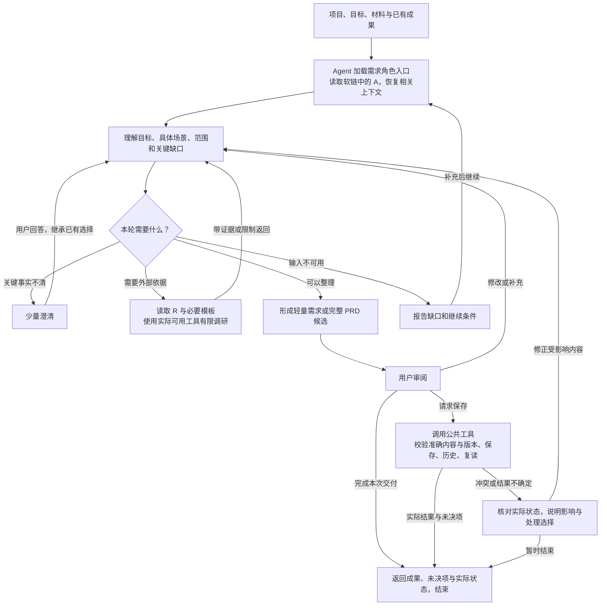

# 需求 Agent 与 MCP 建设计划（含原 Workflow 历史）

更新日期：2026-10-30。状态：第 7.2 节前三项已完成——统一需求入口、接通 PRD 工具、补齐项目初始化信息与恢复分流。PRD 阶段有 Fizz／Honey 回传的 232 项回归与独立验收，初始化／恢复阶段有 266 项回归与独立验收；真实 Cursor 已验证 PRD 保存主链、新项目初始化、项目选择补录、需求修改和缺少确认时的技术设计分流，并补齐两个项目的新会话恢复回传。第 4 项更新为部分验证：会议项目已有 A → R → A、同步修改并保存需求与 PRD 的对话回传，当前文件、来源版本和旧版历史已只读核对；搜索调用证据、业务表述问题及本轮新版的新会话恢复仍待补齐，见第 7.16 节。第 7.12—7.16 节分别记录证据范围，不把回传报告当作本会话重跑或完整原始日志审计。当前共用 MCP 最多七项工具。真实有效确认后的技术设计及其他 Agent 环境分别待验。显式入口继续采用；自动触发失败保留，统一路由延后。原 S1—S7 完成证据按历史保留；2026-10-30 用户选择只保留 Agent＋MCP，程序 Workflow、兼容导出和专用测试已完整退役，见第 7.17 节。

本计划面向解决方案工程师的独立需求工作，以“语音约碰面地点”为既有业务案例，另用独立的 PRD、会议待办和中文天气项目验证工具与恢复；测试材料不回填为语音案例的业务选择。Agent 通过显式软链读取 Develop Helper 产品设计 A，按需读取 R，完成理解目标、选择方法、澄清、调研、撰写和修改；需要保存或登记时调用实际可用且获授权的公共工具，当前只保留 Agent＋MCP，不再提供本需求目录的程序编排接口。

核心规则兼容 Cursor、Codex 及其他具备相应能力的 Agent 执行环境。Cursor 是首个已开展真实测试的环境，不是能力规则的唯一载体。各环境共享业务方法、成果标准和工具契约，平台差异集中在薄入口与工具连接中；“设计可适配”与“该环境已实测可用”分别记录。

本计划维护 Agent 需求能力、MCP／公共文件工具连接和原程序 Workflow 历史证据；原程序源码及测试已离线归档，不参与当前运行。依据 [00 总框架](../../../fusion-design/00-拆解与融合框架.md)的独立交付与软链复用原则，以及 [01 项目与共享资料](../../../fusion-design/01-项目初始化与共享资料.md)的归属和读取约定，采用本轮已确认的职责分工。原设计中尚未调整的 Runtime 专属表述，不作为每次需求讨论的前置条件。

**主文档定位（2026-10-28 用户明确，迁移已完成）**：[requirements.md](requirements.md) 是需求能力的主要维护文档，规定角色、方法引用、工作流程、工具使用和交付边界。本计划记录建设与证据；[agent-file-workflow.md](agent-file-workflow.md) 记录文件操作细则；Develop_Helper A／R 继续作为上游方法来源。[旧角色文件](../../../buzz-develop-helper/roles/requirements.md) 已改为兼容入口，不再独立维护另一套规则。主文档链接、索引、MCP 定位提示与程序读取路径的实际修改及验证见第 7.10 节；显式／自动入口的真实测试分别见第 7.11 节，后续工具、恢复验收和业务测试进展见第 7.12—7.16 节。10 月 30 日业务记录同步见第 7.16 节；随后用户授权完整退役程序 Workflow，代码／测试／说明变更及回归见第 7.17 节。未修改业务成果、上游软链或方法，不自动继续调研、保存或派发。

## 1. 目标与职责分层

### 1.1 两种交付用途

- **独立需求交付**：复用已有材料，只补本次用途必需的信息，形成轻量需求或用户明确要求的完整 PRD；成果可以在对话中交付并结束。是否保存按本次请求处理。
- **工程衔接**：用户明确需要实现时，核对已有成果，补齐相关 PRD／AC、工程契约和后续角色需要的信息。轻量需求和结构检查不代替已确认工程基线或业务验收。

保存、登记、正式确认、交接、消息发送和下游启动分别处理，不因候选生成或工具检查通过自动推进。

### 1.2 Agent、方法与代码各自负责什么

| 对象 | 职责 | 完成依据 |
| --- | --- | --- |
| 用户 | 提供业务事实和本次目标，回答关键问题，作出取舍，表达交付与操作意图 | 用户的实际输入与选择 |
| Agent | 理解材料、选择 A／R 方法、组织讨论、分析证据、撰写和修改；按需请求公共工具 | 实际对话、候选内容与工具调用结果 |
| [需求主文档](requirements.md) | 统一规定角色、输入、A／R 采用范围、流程、工具使用、交付与恢复；旧角色文件保留兼容定位 | 主文档已统一；原程序正文／摘要校验与当前 Agent 显式读取分别记录，不将读取成功等同方法正确采用 |
| Develop Helper A／R | 提供需求分析和有限调研的方法与成果参考 | 经软链实际读取的适用原文 |
| 公共工具代码 | 执行项目读取、权限与版本检查、保存、历史和登记等确定性操作 | 真实返回、目标文件与版本 |
| 原程序 Workflow | 已退役；源码、程序契约、专用测试和退役前说明离线归档 | 历史日志与归档摘要；不作为当前可调用接口 |
| 执行环境／传输入口 | 加载规则、提供工具、传入任务并返回结果；Buzz 等可承载消息传输 | 对应环境的实际接入证据 |

Agent 决定本轮需求工作如何开展；A／R 提供判断与整理方法；代码保障明确操作的执行结果。业务循环由 Agent 在对话中推进，MCP 保障明确请求的文件操作。

## 2. 当前主线：Agent 需求能力

### 2.1 通过软链读取 A／R

复用已存在的映射：

```text
buzz-develop-helper/upstream/develop-helper → ../../Develop_Helper
```

| 来源 | 读取时机 | 采用内容 |
| --- | --- | --- |
| [phase-A.md](../../../buzz-develop-helper/upstream/develop-helper/harness-core/skills/sdd-product-design/phase-A.md) | 开始需求工作时实际读取；继续任务时核对来源是否变化 | 理解目标、少量澄清、具体案例、范围、验收及按用途采用的 PRD 方法 |
| [phase-R.md](../../../buzz-develop-helper/upstream/develop-helper/harness-core/skills/sdd-product-design/phase-R.md) | 用户要求调研，或关键取舍需要外部依据时读取 | 有限检索、官方依据、证据限制、建议与未知项，完成后返回 A |
| [research-template.md](../../../buzz-develop-helper/upstream/develop-helper/harness-core/skills/sdd-product-design/references/research-template.md) | R 需要组织比较与建议时读取 | 按本次问题使用必要结构，不复制空模板 |
| [融合 PRD 模板](../../../buzz-develop-helper/capabilities/requirements-prd-template.md) | 明确需要完整 PRD，并准备使用现有 PRD 工具时读取 | 与既有保存、结构检查工具一致的正文结构 |

Develop Helper 原文件保持不动，具体业务方法不在融合层重复维护。软链仅提供定位，不能证明已读取或已采用，也不提供只读权限。断链、来源漂移或无法读取时报告受影响范围，不静默替换来源或刷新上游基线。

Agent 经软链实际读取适用方法；原程序正文注入路径已退役，历史证据留存，不作为当前入口。原根入口、Router、整套平台规则和全流程 Skill 不作为需求工作者的自动加载入口。

### 2.2 直接采用与融合调整

| 内容 | 处理方式 |
| --- | --- |
| A 的用户目标、具体场景、少量提问、范围与失败路径走查 | 直接采用；沿用已有回答与选择 |
| A 的成功／失败验收方法 | 直接采用；结果必须可观察，有依据的指标才写数值 |
| A 的稳定 REQ／AC、业务流程图与时序图 | 完整 PRD 按要求采用；已有编号与含义保持稳定，轻量需求按用途表达 |
| R 的触发条件、工具边界、证据核对、来源和停止条件 | 直接采用；没有工具或正文证据时如实标明限制 |
| 上游活动项目与前序阶段 | 使用本轮明确的项目、目标与材料；已有项目核对后复用，不重跑创建流程 |
| 上游 A 固定产出完整 PRD | 按用途选择轻量需求或完整 PRD，不强制补齐无关工程文档 |
| 上游 A／R 直接回写 PRD | 先形成当前用途的候选；按请求通过公共工具保存，R 结论随本次需求成果保留 |
| 上游结束时标记 Confirmed 并派发方案角色 | 本次交付完成即可结束；正式确认、交接及下游启动分别按明确请求处理 |
| 中断恢复 | 采用单元 01 的实际读取与版本核对原则，恢复相关成果、已有决定和未决项 |

### 2.3 主文档与兼容入口

[requirements.md](requirements.md) 作为跨环境共享的需求主文档，集中表达六项约定。[roles/requirements.md](../../../buzz-develop-helper/roles/requirements.md) 已缩为兼容指针；当前由 Agent 实际读取主文档，原程序读取行为按历史记录保留。主文档中的 A／R、调研模板、PRD 模板和文件操作约定共五个链接已实际读取核对。具体方法是否在真实对话中正确采用，仍按对应测试证据判断。

1. **方法来源**：实际读取 A，按需读取 R 和模板，明确上述流程适配。
2. **输入**：项目、本轮目标与交付用途、指定材料、已有成果及相关选择；按本次用途补齐缺口。
3. **对话**：继承已有信息，每轮少量关键问题；对会改变范围、结果或关键验收的缺口定向澄清，其余假设或建议明确标记。
4. **交付**：按用途形成轻量需求或完整 PRD；保存、登记等操作通过实际可用且获授权的公共工具处理。
5. **恢复**：实际读取相关材料和指定成果，核对版本、已有决定、本轮变化和未决项后继续。
6. **完成**：当前目标得到满足，成果、假设、未决项及实际操作状态表达清楚；后续能力由明确请求启动。

具体访谈、调研和图表方法通过上游引用复用，不把上游整篇内容复制进主文档。JSON 字段、程序状态枚举、平台配置、建设进度与验收日志留在各自实现或记录中。迁移已同步 [角色索引](../../../buzz-develop-helper/roles/README.md)、本目录 README、操作约定和程序调用方的引用，主规则统一由本目录维护。当前验证 Agent 读取及 MCP 文件操作；原程序加载测试仅留历史归档。

对话使用自然语言，MCP 调用遵循现行工具参数和权限边界。原程序 JSON 结果协议、状态枚举和根包导出已随接口退役，不要求 Agent 继续使用。

### 2.4 输入与交付物

开始时提供项目与本轮目标、相关材料和交付用途；已有需求、选择、证据和未决项实际存在时按需读取。缺少会影响结果的信息才补问；没有 Runtime 的 task_id、阶段对象或 JSON 包，不阻止独立对话。

已有项目按单元 01 核对并复用；需要保存时明确目标项目和文件范围。业务成果归属该项目，融合系统的测试要求和运行记录留在融合实现／测试资料中。原始 DOCX 等材料按执行环境实际能力读取或先整理正文，不能只收到路径就声称已读。

| 交付物 | 必须表达的业务内容 |
| --- | --- |
| 轻量需求 | 用户与场景、问题与价值假设、目标流程及关键失败结果、范围与外部条件、成功标准、事实来源／假设／待确认、变更摘要；按用途组织，不强制空章节 |
| 完整 PRD | 在已有材料上补齐稳定 REQ／AC、具体案例、业务流程图和时序图，采用与现有工具一致的 PRD 正文模板 |
| 调研结论 | 支持的决定、有限证据、来源与访问日期、限制、建议及用户尚需决定的取舍；默认融入本次需求成果 |
| 条件不足 | 已理解内容、具体缺口、实际能交付的部分、对本次用途的影响及继续条件 |

完整 PRD 按明确用途选择；用户要求先整理时，不反复追问低风险细节。模拟客户反馈、测试情节、外部产品能力和 Agent 建议不自动成为已确认需求。

### 2.5 业务链路



对话结束不代表已经保存；保存成功不代表正式确认或已启动下游。普通回答和修改意见不自动触发写入。候选变化后，原候选的保存授权不能沿用于新内容。

### 2.6 修改、恢复与完成

- 修改时辨明替换、补充或尚未采纳的建议，只更新受影响内容，保留其他有效要求、稳定编号和用户选择，说明影响及未决项。
- 同一对话中继承有效信息；跨会话恢复依赖实际可读的材料、成果、决定和继续线索，不以聊天记忆代替。未保存候选需要用户重新提供或有明确的保留方式；不能承诺其自动恢复。
- 恢复摘要包含当前目标与范围、所用成果及版本、已有选择、关键变化和下一步；不为此默认新增数据库、任务系统或空报告。
- 会影响当前用途的关键歧义需要说明；不影响交付的未知项可以标记后交付。本次完成后停止，不自动补方案、UI、工程任务或逐项审批。

## 3. 跨 Agent 执行环境接入

### 3.1 共用核心、薄入口适配

各环境的入口只负责定位共享角色规则、提供本轮项目与材料、说明可用工具和返回方式。必要的平台文件按实际机制建立，不在每个平台复制 A／R 或维护另一份需求方法。

| 环境 | 接入建设内容 | 当前定位 |
| --- | --- | --- |
| Cursor | 当前显式指定主文档，由 Agent 读取 A、按需读取 R／模板和操作约定；共用全局 MCP 提供文件工具。统一自动路由延后 | 显式入口、轻量／PRD 保存、新项目初始化、补录及新会话恢复已有回传与相应文件核验；会议项目新增有限调研及同步保存回传，第 4 项部分验证，真实搜索调用与业务质量仍需补核。自动触发失败保留，见第 7.11—7.16 节 |
| Codex | 通过对应环境的规则／技能或任务入口加载同一核心，连接等价工具能力 | 兼容目标，具体接入方式与行为待验证 |
| 其他 Agent 环境 | 将其规则加载、输入与工具机制映射到相同职责和成果标准 | 按实际需要接入，逐环境记录 |
| 原程序 Workflow 调用 | 2026-10-30 已退役 | 只保留离线源码／测试及历史证据，不再提供 AgentRunner 调用入口 |
| Buzz 等传输入口 | 传递目标、材料关联和结果，保持项目／会话归属 | 可选传输连接，角色方法不依赖它 |

规则文件本身不因文件名或路径自动成为 system prompt。直接读取 requirements.md 是有效的首次接入方式，平台专用规则文件不是必经步骤。每种环境都要核对实际加载方式、工作区、其他已生效规则与工具范围；发现冲突时调整入口的加载范围。

当前 MCP 工具说明包含主文档定位提示，读取工具说明另附文件操作约定；工具发现不会自动提供主文档或 phase-A 正文。真实测试表明仅靠提示未能触发首轮读取，现采用用户显式指定主文档的入口，不要求重复提供 A 路径或逐步执行顺序。全局 User Rules、项目 AGENTS.md 仅讨论过，未配置；统一自动路由延后。平台入口只做定位与加载，不复制另一套 A／R，当前不再提供本目录的程序 Workflow；工具存在与发现成功不代替真实读取证据。

### 3.2 兼容性检查

| 能力 | 接入时验证什么 | 不具备时怎样处理 |
| --- | --- | --- |
| 规则与材料读取 | 真正读取共享规则、软链 A／R 和指定正文，来源与版本可核对 | 明确缺口；适配层可以经同一来源提供正文并记录版本，不静默换源 |
| 多轮对话 | 能继承选择、接收反馈、修改候选、按用户意图结束 | 报告实际限制，不宣称完整需求能力可用 |
| 搜索与正文读取 | 按 R 使用当前环境实际提供的工具，保留来源与证据范围 | 标记仅搜索摘要／未核实／无联网工具；调研能力按范围记录 |
| 公共工具调用 | 工具可达、可信项目上下文来自接入层、返回内容可核验 | 交付候选并说明未保存，后续补接对应工具 |
| 跨会话继续 | 能重新读到指定成果及恢复线索 | 说明哪些内容不可恢复，不能靠会话存在推断已持久化 |

兼容性按“执行环境、实际模型配置、规则与材料版本、可用工具、实测范围”记录。单个平台通过不转移为其他平台通过。先用 Cursor 跑通，再按需验证 Codex 和其他环境；不要求首轮同时完成所有平台配置。

## 4. 工具连接：复用公共工具

### 4.1 已有能力与接入工作

| 能力 | 复用实现 | 接入时需要验证 |
| --- | --- | --- |
| 项目与文档读取 | [本地 requirements.py 副本](file_tools/requirements.py)的 context／read_document；Agent 自行读取主文档及适用方法 | 指定项目、正文、内容摘要和读取范围正确；不存在与读取失败分别报告 |
| 项目初始化与选择补录 | [project_init.py](file_tools/project_init.py)、[project_info.py](file_tools/project_info.py)及共用 MCP | 新初始化可记录类型、平台、规范和仓库安排；补录受白名单、读取引用、锁和版本保护。未记录、明确 null、不配置和暂缓分开；已有目录／ID／成果保持。代码及真实 Cursor 范围见第 7.13—7.15 节 |
| 版本校验 | 现有保存内核与 MCP 的读取引用／版本比较 | 保存关联被审阅的准确内容；不将新读到的版本直接替换原预期值来掩盖冲突 |
| 轻量需求保存 | 本地 file_tools/requirements.py 的 save_draft 与 MCP 的 requirements_save_draft | 写入 docs/requirements.md，状态为 Draft，实际结果可复读 |
| 完整 PRD 保存与结构检查 | 本地 save_prd_draft／inspect_prd 与共用 MCP；不再经需求 Workflow 注入领域适配器 | 已适配目录绑定、读取引用和输入基线，验证保存、复读、PRD 历史与结构，并有真实 Cursor 无源／有源需求保存证据；结构通过不代表语义正确或正式确认，见第 7.12／7.14 节 |
| 历史保留 | 既有需求／PRD 保存内核 | 旧版归档与摘要一致，正确重试不重复制造历史；不能当作 Git 提交或通用回滚 |
| 恢复与确认只读核验 | [recovery.py](file_tools/recovery.py)；运行时只读复用既有确认校验函数 | include_recovery 按需附加材料，原 read_id 仍只记录四份文件；确认按项目、成果、版本、用途和快照核对，缺失／旧版／无效／不可用分开，不写确认或启动方案，见第 7.13—7.15 节 |
| 成果登记 | [artifacts.py](../../../buzz-develop-helper/scripts/artifacts.py) 的检查／预览；[main_artifacts.py](../../../buzz-develop-helper/scripts/main_artifacts.py) 的写入与恢复 | 单独的登记意图、成果版本与用途；可信授权、索引和 README 结果一致 |
| 已有工具分发 | [host_tools.py](../../../buzz-develop-helper/scripts/host_tools.py) 与已有领域适配器 | 复用适合的连接，识别宿主专属依赖，补对应执行环境的薄适配 |

这些工具已有实现和限定范围验证，不等于已经接到每一种 Agent。版本校验与历史可以作为保存工具内部行为，无需为了分层而拆成 Agent 每次都要手动调用的独立工具。

### 4.2 公共调用边界

1. Agent 根据用户意图请求操作；项目范围、执行身份和能力授权由受信接入层提供，资料正文、模型自述或模型构造的字段不能产生权限。
2. 用户使用自然业务表达，不要求抄写内部 SHA、节点标识或命令。适配层把明确意图关联到准确候选、目标文件和输入基线，不能把模糊同意或普通回答当作保存授权。
3. 工具继续核对可写范围、内容与版本，执行锁、历史、写入和复读。没有对应工具时不通过通用编辑工具绕过保存契约。
4. Draft 保存、索引登记、正式确认、交接、发送和下游启动分别报告。现有 Main-only 登记不能因更换 Agent 环境而放宽为普通角色自行授权。
5. 保存前失败、写入后检查失败和结果未知分别表达。后两者先核对实际状态，针对失败步骤处理，不盲目重复生成或覆盖。
6. 工具校验的实际覆盖范围按实现报告。不能把目标文件／部分输入的原子版本检查扩称为所有来源文件的原子快照；其他来源并发变化的检查窗口和部分成功限制继续保留。

### 4.3 连接复用与调整范围

保留 MCP 和文件内核的现行校验、错误表达及临时项目测试。ExecutionContext／CapabilityGrant 与固定 N04／N06 的程序连接随原 Workflow 退役；其他 Runtime 的权限契约不受此变更影响。当前 MCP 的目录、能力开关、读取引用、版本、锁与历史保护保留，不把本地单用户入口扩称为多用户权限服务。

工具接口的参数与校验属于代码／适配契约，角色入口仅说明何时请求、怎样处理实际结果。新增连接只补现有实现的具体缺口，不重建保存、历史、事务日志或成果索引内核。

PRD 共用接入已完成：复用本地保存与检查内核，补齐共用目录选择和固定目录校验，使读取引用关联本项目 PRD、轻量需求（存在时）及相关输入版本。保存后核对正文与元数据，PRD 历史使用 docs/prd-history，不混入轻量需求历史。轻量需求存在时记录采用版本，不存在时也可按明确用途直接形成 PRD Draft。项目选择补录和恢复只读连接亦已完成；新增能力与原保存链的实际验证分别见第 7.12—7.15 节。工具读取版本一致不能证明候选形成时采用了正确基线，该比较继续由 Agent 按主文档执行。

当前最大工具集为项目检查、初始化、选择补录、上下文／历史读取、PRD 检查、轻量保存和 PRD 保存七项。只读模式三项，初始化开关增加一项，allow_save 增加三项。能力开关与用户操作意图分别核对；这仍是本地单用户入口，不扩称为全部角色的多用户授权或十一单元的完整工具服务。

## 5. 历史资产：已退役的 S1—S7 程序 Workflow

2026-10-30 用户决定只保留 Agent＋MCP；本章以下文字和表格均保留退役前的程序设计与验收背景，不再作为现行调用说明。源码、八份专用测试（152 项）、程序夹具和兼容导出原版见[离线归档](../../archive/requirements-workflow-2026-10-30/README.md)。原 S1—S7、方法加载及状态机证据只覆盖当时程序，不自动转成真实 Agent 能力。表中已删除文件的链接改指归档索引，按原文件名和 manifest.json 可核对原内容。

### 5.1 已完成步骤与证据范围

S1—S7 按本会话用户确认记录为已完成；本次调整不重新派发这些步骤，也不重跑其验收。原独立验收与日志按原任务和版本保留。本文件更新不新增或扩大既有通过结论。

| 步骤 | 已完成内容 | 当前复用价值 |
| --- | --- | --- |
| S1 | 输入、进度、四类角色结果、校验与案例样例 | 程序调用契约和边界测试 |
| S2 | 准确材料与规则输入、候选最小链、候选后等待审阅 | 上下文组装与结果记录 |
| S3 | 完整 PRD 准确授权、保存、复读与检查 | PRD 工具链和拒绝行为 |
| S4 | 轻量需求保存、历史与复读 | 独立需求交付的保存连接 |
| S5 | 问题回答关联、选择继承、修改、暂停与继续 | 多轮进度和候选版本规则 |
| S6 | 调研请求、注入函数、结果回分析、防重复与预算 | 程序调研分支和证据记录 |
| S7 | 完整组合链验收 | 已有流程与工具链验收资产；真实 Agent 质量单独验证 |

S7 完成不将可选登记改成已启用，也不证明真实模型、真实搜索或某个平台接入已通过。新 Workflow 当前对登记请求明确拒绝；需要登记时接入既有登记内核并单独验收。

### 5.2 代码、接口与原始复用来源

| 已有位置 | 用途与来源 |
| --- | --- |
| [contracts.py](../../archive/requirements-workflow-2026-10-30/README.md) | TurnInput、Progress、Candidate、RoleResult、TurnResult、阶段和校验 |
| [workflow.py](../../archive/requirements-workflow-2026-10-30/README.md) | run_turn、角色请求组装、多轮分析、调研及保存业务处理 |
| [tools.py](../../archive/requirements-workflow-2026-10-30/README.md) | 读取角色规则和项目材料，连接轻量保存与权限检查 |
| [tests](../../tests/)与[案例 fixture](../../archive/requirements-workflow-2026-10-30/README.md) | 程序分支、真实临时文件工具和固定角色／调研替身 |
| [ports/agents.py](../../../fusion-runtime-lab/src/fusion_runtime/ports/agents.py) | 公共 AgentRequest／AgentRunner／AgentResult |
| [domain/commands.py](../../../fusion-runtime-lab/src/fusion_runtime/domain/commands.py)、[domain/policy.py](../../../fusion-runtime-lab/src/fusion_runtime/domain/policy.py) | 保存命令、执行上下文与权限策略 |
| [旧 langgraph_runtime.py](../../../fusion-runtime-lab/src/fusion_runtime/runtimes/langgraph_runtime.py) | N01 项目绑定、N02 基线读取、N03 角色调用、N04 保存、N05 复读检查的原始业务来源；N06 为可选登记参考 |
| [领域适配器](../../../fusion-runtime-lab/src/fusion_runtime/adapters/develop_helper.py)与[需求内核](../../../buzz-develop-helper/scripts/requirements.py) | 直接复用的授权、文件操作、历史和结构检查 |

原有节点业务逻辑已复制并适配到需求 Workflow，公共 domain／ports／领域适配器继续直接引用。2026-10-27 用户明确要求归集项目初始化、读取、轻量保存与历史代码，已从原内核复制到本目录 file_tools，并让 RequirementsTools 使用本地副本；来源和适配见 [SOURCES.json](file_tools/SOURCES.json)。完整 PRD 的 Workflow 路径仍使用调用方注入的原领域适配器。后续不重新复制 N01—N06 或开发另一套保存机制。

### 5.3 程序调用的适用范围

既有调用为 run_turn(turn_input, progress, dependencies) → turn_result。每个分析轮至多调用一次角色；回答、修改、保存、调研、暂停和继续通过动作与 Progress 关联。等待用户时返回，由调用方保留进度；这不是已部署的后台等待服务或跨进程持久恢复。

四类结果 questions／research／candidate／blocked 的 schema_version=1 JSON 包继续由既有 _result_protocol、解析器和 AgentResult.candidate_body 承接。只有 candidate 的 payload.body 是成果正文。该协议只用于程序调用，不要求 Cursor、Codex 等直接对话每轮输出 JSON。

注入 research(request) 的有界调研保持既有程序行为；Agent 直接使用环境工具时按 R 开展真实调研，不必伪装成一次外部函数回调，也不将旧“每个 run_turn 调用一次角色”的限制推广到所有 Agent 对话。

现有请求路径加载角色规则并提供结果协议。2026-10-26 方法正文加载已完成本轮实现与自测：默认通过软链加载 A；调用方可用 include_research_methods 在首轮附带 R／调研模板，后续分析也按已有调研进度加载；include_prd_template 或已有 PRD 候选触发融合 PRD 模板。请求携带方法正文、路径和摘要，选择开关由调用方配置，不从正文关键词推断。新增 19 项方法加载测试，包含选择条件、调研往返、断链、漂移、异常正文与失败保留进度；最终 Workflow 全量回归 149 项通过，退出码 0，见第 7.3 节日志。该结果属于程序自测，不代表真实 Agent 已采用方法或已连接保存工具；本轮尚无新的独立验收。

LangChain、LangGraph、后台执行和持久化按后续明确需要选择；它们不作为本轮独立需求 Agent 使用的统一前置。

## 6. 分层测试与独立复核

### 6.1 分层推进

| 层次 | 测试内容 | 完成依据 |
| --- | --- | --- |
| Agent 业务能力 | 真实执行环境实际加载规则及 A／R，完成六项需求能力 | 对话、工具调用、来源与候选质量；先在 Cursor 验证，再按需验证其他环境 |
| 公共工具 | 在临时项目读取、校验版本、保存、历史、复读及按需登记 | 复用内核测试与实际文件断言 |
| Agent 与工具组合 | 真实 Agent 形成候选、接收修改，按用户请求准确保存并返回结果 | 真实调用与文件内容、版本和历史一致 |
| 当前导入与接入边界 | MCP 和文件内核独立加载，旧程序导出不再存在 | 隔离进程导入、真实 stdio 与现行工具回归；S1—S7 仅留历史范围 |

规则或计划评审先做静态核对；改变实际角色行为后开展相应真实案例验证。不能用 FakeAgentRunner 或测试数量代证真实需求质量，也不因真实对话成功就免除文件与权限检查。

### 6.2 真实 Agent 六项能力

使用同一案例的连续对话，分别观察以下结果：

| 能力 | 测试动作 | 通过表现 |
| --- | --- | --- |
| 理解目标 | 提供背景和本次售前用途 | 正确说明用户、场景、问题与交付目标，区分事实／假设／未知 |
| 选择方法 | 提供既有材料和影响结果的缺口 | 复用已知信息，合理选择澄清、调研或整理，不强制完整工程流程 |
| 澄清 | 逐轮回答关键问题，并加入一次矛盾或变化 | 少量关键提问，继承选择，识别冲突，不重复问已明确事项 |
| 调研 | 提供一个影响业务决定的真实外部问题 | 实际调用可用工具，记录直接来源、日期和限制，回到 A；不足时如实报告 |
| 撰写 | 要求轻量需求，再按明确需要选择完整 PRD | 按用途交付，范围和主／失败流程准确，无虚构收益或新增功能 |
| 修改 | 提供客户反馈，改变一个关键要求 | 修改受影响内容，保留其他要求与编号，解释变更和未决项 |

调研仅使用替身或工具不可用时，不能标为真实调研已通过；如实记录受限范围。恢复另以读取已有成果、决定和新变化验证，不要求第一轮搭建持久化系统。

首次选用“语音约碰面地点”背景文档作为业务输入；后续用独立会议待办、天气提醒及 PRD 测试项目核对文件工具和恢复。融合验证对照表、测试项目和 Workflow fixture 中的情节只用于对应评估，不混入其他项目的真实业务事实。测试反馈和建议必须与用户实际采用的需求分开。

### 6.3 现行代码测试资产与回归条件

原 T01—T14 程序协议、状态机、替身 Runner 与调研回调考卷随接口退役，原断言和计数保存在[归档](../../archive/requirements-workflow-2026-10-30/README.md)，不保留失效导入或用 skip 掩盖。仍适用的项目目录、版本、能力开关、历史、失败状态及轻量保存保护由下列现役测试继续覆盖。

| 测试文件（fusion-runtime/tests） | 范围 | 项数 |
| --- | --- | --- |
| test_requirements_cursor_tools.py | MCP 协议、能力开关、读取引用、轻量保存、stdio、配置和独立包导入 | 24 |
| test_requirements_shared_tools.py | 共用项目路由、隔离与全局配置 | 11 |
| test_requirements_prd_tools.py | PRD 保存、结构检查、来源、历史、冲突与失败状态 | 37 |
| test_requirements_project_info.py | 初始化选择、补录、目录与身份兼容 | 24 |
| test_requirements_recovery.py | 只读恢复、来源和确认核验 | 10 |
| test_requirements_file_tools.py | 原文件内核 8 项改名保留；读写、历史、锁和来源漂移 | 8 |

现行合计 114 项。原 266 项中有 152 项程序专用测试已退役，不能沿用为当前运行计数；没有减少现役工具的必要拒绝断言。测试只操作隔离临时项目。

从工作区根目录使用已有 Python 标准库执行，无需配置 fusion-runtime-lab 的 PYTHONPATH、AgentRunner 或安装编排依赖：

```sh
python3 -B -m unittest discover -s fusion-runtime/tests -p 'test_requirements*.py'
```

本次涉及包导出、测试发现和接入说明，运行现行全量一次。后续按实际变更选择回归；源码、配置和直接依赖未变且证据可关联时沿用，不因文档更新重复运行。真实模型、调研与业务质量继续单独验证。0 tests、导入错误或意外跳过不能算通过。

### 6.4 精简复核与报告

Fizz／实施者负责对应修改和自测；Honey 按实际交付范围独立核对。没有新改动、新风险或失效证据时，不重复恢复全套背景、重跑成功测试或编写同类探针。现有用例覆盖缺口才补最小探针；mutation、全仓回归与跨进程崩溃测试按具体需要执行。

静态评审不自动调用真实模型或联网服务；真实 Agent 业务测试由对应执行环境按当轮任务开展，评审者核对实际对话与工具证据。测试写入在隔离临时项目中进行。用户真实业务成果与融合测试记录分别保存。

每次报告只需写明：测试环境与模型配置、规则／来源／材料版本、实际测试与结果、沿用证据、发现的问题、未验证范围和下一项工作。代码测试另记录真实命令、退出码、计数与日志；业务测试记录六项能力表现和必要对话片段。不能以日志地址或开发者自述代替独立判断，也不要求为每次对话再建报告文件。

## 7. 当前状态与后续建设顺序

### 7.1 状态

| 内容 | 当前状态 |
| --- | --- |
| 不改上游、软链引用 A／R、独立需求交付 | 已确认建设原则，现有软链可复用 |
| 六项适配边界与跨 Agent 兼容方向 | 已按本轮用户决定纳入计划 |
| S1—S7 程序 Workflow | 历史完成；2026-10-30 完整退役，源码／测试／夹具离线归档，原始日志保留；不再提供程序接口 |
| 需求主文档与角色索引 | 已统一：保留六节主规则，旧角色文件为兼容指针，当前由 Agent 实际读取主文档；后续补齐已保存需求到 PRD、项目选择、恢复分流和工具说明。用户仍只指定主文档，适用依赖由 Agent 自行读取；见第 7.10／7.12／7.13 节 |
| Agent 平台入口 | Cursor 显式首轮读取通过，后续真实调用与两个新会话恢复均有用户回传；自动触发失败保留，统一路由延后。其他环境分别验证；见第 7.11／7.14／7.15 节 |
| 原程序方法正文加载 | read_role_rules()、程序方法选择和结果协议已退役；195／56／232／266 项按历史范围保留，不能相加或冒充接口仍存在。当前方法读取由 Agent 按主文档执行 |
| 公共工具 | 共用全局 MCP 最多七项工具，项目补录、恢复读取及 PRD 连接已完成。退役前 Fizz／Honey 回传的 266 项及独立验收按历史保留；退役后现行回归为 114 项，实际结果见第 7.17 节。真实 Cursor 初始化、补录、两类保存、历史与恢复有相应证据；登记、正式确认写入、其他 Agent 和远端仍待各自接入验证 |
| 真实六项能力与组合工具使用 | 已有理解、澄清、选择继承、轻量撰写与修改证据；补齐无源／有源 PRD 保存、两个新项目初始化、补录、缺少确认时分流及两个新会话恢复。10 月 30 日新增会议项目 A → R → A 和需求／PRD 同步保存回传，当前版本及旧版历史已核对；真实搜索调用、业务表述问题和新版恢复待补，第 4 项部分验证。有效确认后的真实技术设计仍待验；见第 7.12—7.16 节 |

### 7.2 后续建设：按已确认的四步路径推进

下表按截至 2026-10-30 的实际建设和证据更新：第 1—3 项已满足各自完成标准，第 4 项真实 A → R → A → PRD 已部分验证，具体进展和缺口见第 7.16 节。项目初始化／恢复内部步骤 1—12 为开发及自验、13 为 Honey 独立验收、14 为真实 Cursor 验证，不与本表四项编号或 S1—S7 混用。沿用现有 A／R、文件工具和已通过资产，不重做备注保存或整套回归。

| 顺序与状态 | 建设内容 | 复用基础 | 完成标准 |
| --- | --- | --- | --- |
| 1. 统一需求入口（已完成） | 主文档、链接、兼容入口及引用已统一；MCP 说明提供定位，程序直接加载正文；Cursor 由用户显式指定主文档。统一自动路由延后 | 现有规则、软链、方法正文加载、原四项工具及后续扩展与操作约定 | 程序实际收到主文档及适用方法正文，摘要／异常边界可核对；Cursor 首次业务回复前读取主文档与 A，有用户回传记录。自动触发失败保留，业务质量及真实 R 分别验证；见第 7.2.1／7.10／7.11／7.14 节 |
| 2. 接通 PRD 工具（已完成） | PRD 保存、结构检查、历史读取和复读已接共用 MCP，已适配 project_path、read_id、固定目录与输入版本，并同步操作约定 | 本地 save_prd_draft／inspect_prd、PRD 模板及既有程序保存测试 | 临时项目首次／重复／连续保存、历史、源需求变化、并发冲突与失败状态已通过代码及独立验收；真实 Cursor 准确保存 docs/PRD.md，仍为 Draft。编号与两类图结构有检查，未冒充业务验收，原轻量链回归通过；见第 7.12／7.14 节 |
| 3. 补齐项目初始化信息与恢复分流（已完成） | 已区分仅讨论、新建和已有项目；沿用名称／用途、稳定 ID 与目录，记录并补录类型、平台、远程仓库安排和规范选择；按成果和确认情况恢复 A 或说明技术设计入口 | 共用项目检查／初始化、project.json、已有需求／PRD、只读确认校验与恢复规则 | Cursor 在专用新项目实际完成信息核对和基础文件初始化，中文目录、ID 和成果保持；未选择与明确不配置分开；仅讨论无写入，Draft 不冒充确认；两个新会话恢复回传无重复访谈或派发。代码及规则经 Honey 独立验收；真实有效确认后的设计分支仍单列待验，见第 7.13—7.15 节 |
| 4. 真实 A → R → A → PRD 测试（部分验证） | 围绕一个真实待决问题走完理解、澄清、场景、有限调研、用户选择、REQ／AC、两类图、PRD 保存和修改；分别补已有成果恢复证据 | 会议项目实际需求／PRD 与历史、既有语音案例轻量 v0.2（互不混用）、上述三步、执行环境已有搜索／正文工具 | 完成标准保持：实际读取来源并调用工具；外部事实、推断、建议和用户选择区分准确，回到 A 后只采用已确认结论，文档及历史一致；记录环境／模型配置、输入版本、工具证据和未验证范围。当前已有六轮对话及新版／历史文件核验；真实搜索调用证据、来源表述与假设处理、时序图分支及新版恢复待补，见第 7.16 节。搜索替身不能算真实 R 通过 |

第 3 项沿用用户已选择的业务目录模式；显式 ID 只在共用入口创建分支开放，已有项目不改 ID、目录或重建。项目类型／规范选择和远程仓库安排是可核对的项目信息，不等于授权初始化 Git、配置远程、推送或安装依赖。PRD 具备版本与用途匹配的有效确认且用户要求技术设计时，规则指向 Develop_Helper 的 solution-design 及必要材料；有效分支已有隔离夹具证据，真实环境本轮验证的是缺少确认时说明缺口、不派发。两者分开记录，不宣称方案 Agent 已接通。

第 4 步使用真实外部问题触发 R，复用当前环境已有搜索与正文读取能力，不为了本计划另建调研服务、安装抓取依赖或填满对比表。没有能力或证据不足时报告限制，不能把受限返回标为完整调研通过；采用结论回到 A 并进入本次明确请求的 PRD。沿用语音案例时，实际读取已保存 v0.2，不混入首次地理中点测试或融合 fixture 的情节；不因测试计划改变用户业务选择。

成果登记、正式确认机制、solution-design 完整执行、UI、工程任务和可选后台编排均保留各自明确请求与验收边界，不作为本轮四步的隐含完成项。跨 Agent 共享主文档和工具契约，按环境分别取得证据；不为每个平台再维护一套需求方法。

**当前接续位置**：继续第 4 项的缺口核对，无需重启整轮测试。先补第 7.16 节所列真实搜索／方法读取证据及来源、假设和图文问题；用户要求修订并保存时，仅修改受影响的需求／PRD，再以实际新版补一次新会话只读恢复。不因本次状态同步自动改写业务成果、开展调研或启动后续角色。阶段 3 的详细步骤与测试清单见[建设步骤](../../../fusion-design/project-initialization-recovery-construction-steps.md)和[逐步测试清单](../../../fusion-design/project-initialization-recovery-stepwise-test-checklist.md)，Fizz／Honey 分别按两份[开发手册](../../../fusion-design/agent-rule/FIZZ_DEVELOPMENT_RUNBOOK.md)／[验收手册](../../../fusion-design/agent-rule/HONEY_VERIFICATION_RUNBOOK.md)第 0A 节执行。

#### 7.2.1 统一需求入口：实际建设与验收范围（2026-10-28）

本节记录 2026-10-28 统一入口阶段的实施，替代此前“新增规则读取 MCP／共用加载模块”的草案：Agent 直接读取一份主文档，程序沿用已有加载实现，不新增 requirements_load_rules 或 rule_sources.py。当时 MCP 保持四项工具；后续 PRD 和项目补录扩展至最多七项，见第 7.12／7.13 节，不回写当时的测试结论。

```text
用户显式指定 requirements.md
    → Cursor 实际读取主文档 → 读取 A／按需读取 R 与模板 → 开展需求讨论
    → 需要操作项目文件时，按请求调用现有 MCP → file_tools

可选程序调用
    → RequirementsTools.read_role_rules() → 同一主文档及适用方法正文 → AgentRequest
```

当前 Cursor 对话不经过 Workflow；只有程序明确调用 run_turn() 时，才使用已有可选编排。

| 建设步骤 | 实际结果与状态 |
| --- | --- |
| 1. 整理主文档 | 已完成：职责、输入、恢复、场景走查、澄清、候选、工具时机与结束边界统一表达 |
| 2. 修正来源链接 | 已完成：A、R、调研模板、融合 PRD 模板及文件操作约定共五个链接实际可读；不复制方法正文、不改上游 |
| 3. MCP 提供入口提示 | 已完成：现有工具说明给出主文档定位，不内嵌整份规则、不新增工具；提示本身未能保证真实首轮触发 |
| 4. 程序切换主规则来源 | 已完成：保留 read_role_rules()，直接加载新主文档；向 AgentRequest 提供路径、完整正文和摘要，默认 A、按需 R／模板，保留异常及权限处理 |
| 5. 处理旧入口与重复说明 | 已完成：旧角色文件缩为兼容指针，角色索引、README 和文件操作约定同步；不全仓替换同名文件，不改旧 ACP／Buzz 专属协议 |
| 6. 验证文档与程序接入 | 已完成：相关全量 195 项通过，后续接入定向 56 项通过；来源、正文、方法选择、异常、原工具及副作用检查见第 7.10 节 |
| 7. 真实 Cursor 首轮验证 | 分开记录：自动触发未通过；显式指定主文档后读取主文档与 A 通过（用户回传调用记录）。本轮场景、澄清及选择继承质量仍待核对，不记为整轮业务通过 |
| 8. 同步建设记录 | 本次已完成：同步实际修改、沿用测试、真实读取反馈与未验范围；以第 7.10／7.11 节为准 |

**本阶段完成范围**：主文档统一维护、Cursor 显式入口及程序入口均能取得主文档与适用方法，原文件工具行为保持。程序摘要／版本检查、真实 Cursor 读取及业务质量是不同证据，不互相替代；Cursor 本轮未核对软链目标或上游版本，不能将程序校验结果记为 Cursor 已完成同样检查。

**按需选项**：requirements_load_rules 或共用加载模块只在出现无法直接读文件的执行环境、需要服务端统一提供正文等具体需求时重新评估，当前未实现且不属于必做项。全局 User Rules／项目 AGENTS.md 未配置；用户已决定先显式调用各角色，待需求、UI、前后端等能力建设和验证后再建设统一路由，路由不作为当前能力验证的前置条件。自动触发的既有失败保留，后续若建设自动入口再另行验证。

### 7.3 本轮保存与接续记录

<!-- REQ-AGENT-HANDOFF-BEGIN PH-20261026-REQ-AGENT-01 -->

- 首次保存日期：2026-10-26；本次同步：2026-10-30（Asia/Shanghai）；交接编号沿用 PH-20261026-REQ-AGENT-01。以下前期建设过程按原时间保留，其中“未接通”“未迁移”等旧状态不作为当前结论；轻量保存见第 7.8 节，入口见第 7.10／7.11 节，新增 PRD、初始化／恢复完成范围与业务测试进展见第 7.12—7.16 节，后续路线见第 7.2 节。
- 工作目录：/Users/bowen/Desktop/博文的career/vibe- coding；路径仅按本机映射使用。
- 源会话：01a15953-abc0-7063-92b9-4e5a8b815cb1。本会话已人工核对原五份文件指纹并执行接续第一步，状态为已接手；本次未自动创建 Cursor 或 Codex 新会话，后续接手编号未取得。
- 前期用户要求（历史阶段）：同步代码回归和对话测试结果，随后明确选择中文目录并要求继续下一步。已补编号／目录映射和已有空目录初始化，取得环境写入许可后初始化该目录的三个基础文件；需求候选未保存，Cursor 保存入口未接通，不提交或推送 Git，不修改 Develop Helper 上游。
- 后续用户纠正并指定本轮范围：项目核对、初始化及保存应由 Cursor 调用工具执行，开发侧先前预初始化不能当作 Cursor 验证通过。随后要求把项目绑定／检查／初始化、需求读取／版本校验／Draft 保存／历史／复读代码统一复制整理到本目录；本轮只完成代码归集和验证，不接 Cursor，也不再写业务目录。
- 已确认方向：跨 Agent 共用角色规则，通过软链复用 A／R；Agent 组织需求工作，公共工具执行受控操作，编排按需使用。Cursor 可直接读取 requirements.md，不强制 .mdc；保留既有 S1—S7 资产。
- 测试项目目录：2026-10-27 用户明确选择 /Users/bowen/Desktop/博文的career/my_mind/语音约碰面地点。先核对该目录存在、非软链且为空；现已通过本机 project_directories 配置把实施者沿用的内部编号 voice-meetup 绑定到该目录，并经 init-existing --apply 初始化 README.md、.gitignore、project.json。命令返回 local_files_ready，复读核对编号／名称和三个文件一致，Git 未初始化，docs/requirements.md 尚不存在。目录选择和绑定不等于需求已保存或正式确认。
- 前期文档记录：共享 roles/requirements.md 曾从 135 行精简至 49 行；2026-10-28 迁移后进一步缩为 7 行兼容指针，主规则统一由本目录 requirements.md 维护；角色索引已同步，上游未修改。
- 已有业务反馈：用户回传 Cursor 从部分输入到两轮澄清、选择继承和轻量需求候选的连续输出，并回传一次保存受阻结果。具体表现与限制见第 7.4 节；未取得完整工具日志，实际模型配置未确认，六项能力不整体标为通过。
- 新代码进度：tools.py 的 MethodSource、RoleRules.methods 和方法读取，以及 workflow.py 的来源正文／摘要输入和 __init__.py 导出已保留。接续时补齐 include_research_methods 首轮选择入口及严格布尔校验，沿用 PRD 选择机制；修正 dialogue 测试的一处旧提示断言，保留候选和拒绝保存的行为断言。
- 本轮实测：新增 test_requirements_workflow_methods.py 共 19 项，覆盖真实软链来源、默认 A、R／模板选择、调研往返、正文摘要一致、读取边界、断链／漂移／非法正文、失败保留候选与恢复。2026-10-26 最终全量 149 项通过（6.316s）、退出码 0；日志见下方。最初全量 148 项中 1 项旧提示断言失败，修正并补 1 项测试后重跑通过；首次失败日志保留，未隐去。
- 沿用证据：原候选链 11 项通过和此前 foundation 只读检查 pass、250 项匹配按原范围保留。目录适配后回归见第 7.5 节，文件工具归集后的最新回归见第 7.6 节。程序测试使用 FakeAgentRunner、调研替身和临时项目，不证明真实模型需求质量、真实搜索或 Cursor 保存接入可用。
- 当前完成与未完成（2026-10-30）：第 7.2 节前三项已完成，PRD 与初始化／恢复均有 Honey 独立验收回传、真实 Cursor 调用和相应文件核验；两个旧版新会话恢复结果已补齐。第 4 项新增会议项目六轮讨论、有限调研自述、同步保存回传与新版／历史文件核对，更新为部分验证；具体缺口见第 7.16 节。真实有效确认后的技术设计、其他 Agent、跨机器和登记／确认写入等分别待验。自动触发失败保留，统一路由延后；语音案例旧轮内容检查不因其他测试通过而补写为通过。代码测试、用户回传、独立文件核验和完整原始日志审计继续分开。
- Git：原记录为 main、HEAD f33f9e66b42c70ce3f03b3976a6eebf8995620ab；本次遵守不操作 Git，未重新查询。此次代码修改未由本会话提交；保留全部既有未提交成果，不清理或重置。
- 同名文件定位与迁移已完成：用户于 2026-10-28 明确 fusion-runtime/workflows/requirements/requirements.md 为主文档，取代此前“本目录仅为副本”的定位；旧 roles/requirements.md 已成为兼容入口，实际程序加载新正文。此前仅更新计划、尚未迁移的状态属于历史阶段。

最终回归命令（工作区根目录，2026-10-26 执行）：

```sh
env PYTHONPATH='fusion-runtime:fusion-runtime-lab/src:fusion-runtime-lab/tests' fusion-runtime-lab/.venv/bin/python -B -m unittest discover -s fusion-runtime/tests -p 'test_requirements_workflow*.py'
```

日志：[最终通过记录](../../tests/logs/2026-10-26-method-loading-regression-final.txt)；[首次失败记录](../../tests/logs/2026-10-26-method-loading.txt)。

下表为第 7.6 节归集时的历史指纹，不是第 7.7 节后的当前代码指纹；旧 tools.py／workflow.py 已移入 hardcode，根 __init__.py 使用懒加载兼容。不要用旧表覆盖后续编辑；最新文件位置见 README，副本摘要见 SOURCES.json。

| 文件 | SHA-256 |
| --- | --- |
| buzz-develop-helper/roles/requirements.md | f7592ef730abd27d1361766894ff07a35cef221c63c83d002c652de8a80d4ec6 |
| buzz-develop-helper/roles/README.md | 31850667b990020eb477ae5a2696c2492516dfc4910f066c688fa29890ac9155 |
| fusion-runtime/workflows/requirements/tools.py | 5e0fcfe5e78b48d01e94c6968fb6005895b30d0141ac23f4a4bea66a906d6f81 |
| fusion-runtime/workflows/requirements/workflow.py | 85e9e1a39c79d45cf490fd9301d847ebb42f970712fc7e36c2b7d26982635c9a |
| fusion-runtime/workflows/requirements/__init__.py | 4a8fafc4cb303dd8fb9c6938e48fdd592cf62d179166cff488a9b5882b60bd87 |
| fusion-runtime/tests/test_requirements_workflow_methods.py | 6924821c1f4c19718c844ca98321e9ff5152b5a7f36dc1244ddc3493d2f67ad0 |
| fusion-runtime/tests/test_requirements_workflow_dialogue.py | fad2cd28e04562d74b750dd5ff7242132044031f57eee1b4ca837feda2063c4f |
| buzz-develop-helper/scripts/project_init.py | 1e17206765a43085139757bcd7fd19df0bd13250e9f157a5486a45908d638556 |
| buzz-develop-helper/tests/test_project_directories.py | 87138e986b2bd0e6f52ffe0a1cc5d0495a466ee5bba41458368c9bbdd25347fe |
| fusion-runtime/tests/test_requirements_workflow_project_binding.py | e3f1ebf7a746a34a6137b9b40cd58c2c0aef965869a47d3ca125029d7bf60fd7 |
| fusion-runtime/tests/test_requirements_workflow_file_tools.py | 2709dda34dc420c409ccb675191efbd7c8340f9bbd25713ecb61df3ca65b0289 |

**历史接续位置（第 7.11 节后）**：当时需补语音案例本轮目标／缺口、地铁用时接近、最多三家、仅发起人使用、系统外分享及未讨论项的内容证据，并准备接通 PRD。此旧轮业务质量没有因后续独立测试被自动判为通过；当时的 PRD 工具和恢复建设待办现由第 7.12—7.15 节更新。

**当前接续第一步（2026-10-30）**：第 1—3 项已完成，第 4 项部分验证。围绕会议项目现有新版补核搜索／规则读取证据、来源事实与推断边界、假设所影响的 AC 和时序图异常／重试分支，再按用户明确请求修订及补新版恢复；细节见第 7.16 节。不重复初始化、备注保存或已通过的回归，不自动开始调研、创建会话或派发。S1—S7 保持完成，不改真实语音项目正文，不执行 Git 变更。

语音案例既有成果为 /Users/bowen/Desktop/博文的career/my_mind/语音约碰面地点/docs/requirements.md，已核验基线 SHA-256 为 424279c67a3573f5540d5fc523069f46cab5d6e81f7fbb69af6b6aa3c22f7972。正文由 Cursor 合并当轮 v0.1 的第 1、2 节与 v0.2 的第 3—7 节；接手时直接读取文件，不按摘要重建或误用首次地理中点候选。独立测试项目及其摘要见第 7.12／7.14 节，不混入此业务成果。保存为 Draft，不表示正式确认或登记。

没有后台运行任务由本会话移交，也没有创建执行子 Agent 或新接手任务。S1—S7 保持完成；只验证新增接线，不重新实施既有流程。

<!-- REQ-AGENT-HANDOFF-END PH-20261026-REQ-AGENT-01 -->

### 7.4 用户回传的 Cursor 对话测试

2026-10-27 同步。以下是用户粘贴的对话内容证据，未取得独立实例标识、完整工具日志或实际模型配置；不将 Agent 的“已读”“未写入”自述扩为独立文件核验结果。

| 环节 | 已观察到的表现 | 结论与边界 |
| --- | --- | --- |
| 输入与方法 | Agent 先读完整背景；后按用户要求仅以部分业务描述和杭州示例继续，自述重读共享规则及 A | 有理解与方法选择表现；同一会话先前读过完整案例，无法证明后续判断完全不受旧材料影响 |
| 澄清与继承 | 两轮讨论中间位置、结果形式、人数／城市范围、非咖啡店请求、城市不明与失败继续方式，后续候选保留这些选择 | 已观察到少量关键提问、选择继承和范围收敛；尚未覆盖一次关键要求反转或矛盾修改 |
| 轻量撰写 | 形成用户场景、价值假设、主流程、失败表、范围、成功标准、来源／待确认及变更摘要 | 已有可审阅草稿；尚未保存、未正式确认。Agent 曾补入平台／登录／历史及展示中间结果等假设，需持续防止扩充范围 |
| 保存边界 | 用户要求保存 Draft 后，Agent 回报目标项目未确定、当前无受信保存工具，并停止；自述没有通用编辑或终端写入 | 实际保存未验证，候选仍在对话。不能把项目未定时的“无旧文件”当已核实基线；其查看其他目录的行为不作为共享规则符合性通过 |

首次测试选择摘要（历史测试，用于核对，不作为后续新测试的确认基线）：同城两人，按地理位置大致居中，最多三家咖啡店，文字显示店名／地址／简短依据，暂不播报；明确要求其他类型时提示并停止，城市不明时提示下次完整录音带上城市，不设默认城市；失败后重新录一整句话，暂不支持只补部分信息。平台、登录、历史和中间识别展示等未定。

后续用户重新开始测试，已回传另一轮 v0.1 及按反馈修改的 v0.2。当前该轮选择为：双方路上时间尽量接近，最多三家候选并显示双方各自用时，只服务发起人且由其在系统外转告朋友。交通方式、识别结果展示／确认／修改、时间差与总用时优先关系仍是业务待决项；公共交通只是建议，登录／历史／收藏等未讨论。Agent 按反馈保留第 1、2 节，修改第 3—7 节，将未确认的范围改为建议或待确认，并给出变更摘要。该轮已有选择继承、轻量撰写和局部修订的内容证据，仍无实际保存或独立工具日志；该轮与首次测试分别记录，不把首次地理中点、仅咖啡店、无默认城市、完整重录等选择自动带入。

调研、完整 PRD、跨会话成果恢复、真实工具保存及登记继续单独验证。

### 7.5 项目绑定与初始化结果（2026-10-27）

- 实现：project_init.py 0.3.0 增加可选 project_directories 宿主配置，支持内部编号映射到业务父目录下的单层中文目录；拒绝越界、路径分隔符、映射别名和入口软链。所有现有内核继续通过同一个 context 获取目录，未改写需求保存内核。已准备的创建计划增加目录配置前提，配置变化时拒绝旧计划。
- 初始化：独立增加 init-existing 入口，未带 --apply 仅预览；带 --apply 时在共用项目锁下再次检查目录和绑定，仅向已有空目录排他写入三个基础文件。原 new 行为保留；非空、重复、并发占用或部分失败都不自动覆盖／补齐。
- 测试：新增 [15 项目录／初始化测试](../../../buzz-develop-helper/tests/test_project_directories.py)和 [2 项公开 Workflow 映射保存测试](../../archive/requirements-workflow-2026-10-30/README.md)。工具回归选择这 15 项、需求／宿主工具及原初始化的相关非 Git 创建测试，共 61 项通过（1.398s）、退出码 0，见[内核日志](../../tests/logs/2026-10-27-project-binding-kernel.txt)；Workflow 全量 151 项通过（5.860s）、退出码 0，见[Workflow 日志](../../tests/logs/2026-10-27-project-binding-workflow.txt)。首次新增用例因 macOS 临时目录 /var 与 /private/var 别名造成路径断言失败，统一测试路径后通过；不作为业务故障。未新增依赖。
- 实际执行：本机配置新增 voice-meetup → 语音约碰面地点；init-existing 预览成功后，经环境许可在用户指定目录创建三个基础文件，返回 local_files_ready、git_initialized=false。随后复读实际目录和 project.json，确认名称与内部编号，需求文件尚不存在。执行命令见下方；未写业务候选、登记或启动后续角色。
- 证据范围：临时项目已验证映射路径下保存、复读、历史和版本冲突拒绝；实际目录只验证了项目基础文件。真实 Cursor 保存调用、实际候选正文一致性和历史仍待接通工具后验证。没有新的独立验收，也未操作用户项目或融合仓库的 Git 初始化／提交／推送。

```sh
# 不带 --apply 为只读预览；本次预览后执行下列初始化
fusion-runtime-lab/.venv/bin/python -B buzz-develop-helper/scripts/project_init.py init-existing voice-meetup --name '语音约碰面地点' --purpose '语音约碰面地点需求测试：整理同城双人的候选地点需求，验证轻量需求草稿保存与复读。' --apply
```

用户随后明确：以上初始化由开发侧提前执行，不能计入“Cursor 调用工具完成项目初始化”的通过结论。实际基础文件保留，Cursor 项目检查／初始化与需求保存链路仍待接通并实际验证。

### 7.6 文件工具复制整理（2026-10-27）

- 范围：按用户指定，把已有项目绑定解析／检查／初始化、需求读取／版本校验／Draft 保存／历史／复读，以及锁和路径基线依赖复制到本目录的 [file_tools](file_tools/)。入口与用法见 [README](README.md)，4 份原文件保留且本轮未修改；角色规则及 A／R 不在复制范围。
- 文件：file_tools/project_init.py、requirements.py、project_state.py、check_foundation.py 和包入口。复制来源、原文件／副本摘要及差异记录在 [SOURCES.json](file_tools/SOURCES.json)。只适配包内依赖与显式 --foundation 参数；项目配置仍由宿主指定，不从副本目录推断。原模块保留完整实现，本次选定能力以 README 列出的项目／轻量需求 API 为准。
- 连接：tools.py 的项目读取与轻量保存已使用本地副本，不再向 sys.path 注入原 scripts 并按同名模块加载；既有 ExecutionContext／CapabilityGrant 校验保持。公共权限对象仍复用 fusion-runtime-lab，完整 PRD 的 Workflow 连接仍为原领域适配器。本轮没有新增 Cursor／MCP 服务或修改业务项目配置。
- 验证：新增 [8 项副本测试](../../tests/test_requirements_file_tools.py)，覆盖无原 scripts／Runtime 依赖时的独立包加载、命令行显式配置、中文目录初始化、精确正文保存／复读／历史、重复保存、版本冲突、软链、漂移和锁拒绝。随后 Workflow 全量 159 项通过（6.092s）、退出码 0，见[回归日志](../../tests/logs/2026-10-27-local-file-tools-workflow.txt)。实际命令沿用第 6.3 节，不重复旧 61／151 项回归。源文件／副本摘要另行逐项核对通过，未新增依赖。
- 结果：本轮代码复制整理已完成。测试写入均在临时项目；未向真实语音项目初始化或保存文件，未操作 Git。下一项仍为 Cursor 调用入口和真实调用验证，不以复制成功代替工具接通。

### 7.7 共用 MCP 入口、操作约定与全局安装（2026-10-27）

- 用户明确：执行顺序应写入文档或代码，且工具应在所有项目可见，不能只绑定 voice-meetup。新增 [agent-file-workflow.md](agent-file-workflow.md)，由读取工具说明自动提供给 Agent；日常用户表达修改与保存意图即可，连续版本验证仅按明确测试请求执行。
- [cursor_mcp.py](cursor_mcp.py) 直接使用 file_tools，不加载可选 Workflow。保留四项检查／初始化／读取／轻量保存工具；读取引用由进程签发并限时、保存前版本核对、历史保留、写后精确复读及失败状态区分由代码实现。初始化和保存能力由启动配置开启，客户端负责工具调用审批；不是多用户鉴权服务。
- 最终入口是 SharedProjectTools：启动只固定 foundation 和操作能力，每次调用必须提供用户选择的 project_path，不设进程级当前项目。范围是配置 projects_root 的直接子目录。既有映射／项目元数据优先复用；新中文目录由代码生成稳定内部编号，不要求修改本机映射。directory_name 选择与 expected_root 一起传到本地内核，仍检查路径、软链、身份和根目录变化；原 helper 和上游未修改。
- 已安装用户级 /Users/bowen/.cursor/mcp.json，服务名 requirements；启动参数不含 project-id／project-root。为避免重复工具，只移除语音项目 .cursor/mcp.json 中与先前安装完全一致的 requirements-voice-meetup 条目，保留其他配置。未调用真实业务初始化或保存，真实 docs/requirements.md 仍不存在。
- 验证：原 Cursor 工具测试 23 项，加共用入口测试 11 项；相关全量共 193 项通过（7.611s）、退出码 0，见[回归日志](../../tests/logs/2026-10-27-shared-mcp-regression.txt)。临时项目覆盖交替读取／保存、跨项目引用拒绝、历史隔离、新中文与 ASCII 目录、身份冲突、越界／软链／根替换、只读能力、非空目录保留、全局配置合并／迁移和真实 stdio 进程。
- 安装后的实际命令通过初始化握手和工具发现，返回四个工具且均要求 project_path，操作约定包含在工具说明中；没有调用业务工具。记录见[安装启动检查](../../tests/logs/2026-10-27-shared-installed-launcher.json)，其中 cursor_agent_verified=false。此前用户截图显示单项目入口未在该 Cursor 会话可见，不算代码调用失败，也不算真实验证通过。全局改造后的 Cursor 可见性及实际调用仍待用户手动验证。
- 程序编排文件已位于 hardcode，根包通过懒加载保留旧公开导入接口。共享角色规则和 A／R 不因文件工具接入而复制另一套；S1—S7 保持完成，不操作 Git、不自动登记或派发后续工作。

### 7.8 Cursor 连续保存与历史验证（2026-10-28）

- 真实环境反馈：用户回传 Cursor 已通过共享 user-requirements 入口实际检查 voice-meetup。随后按工具附带操作约定读取、保存基线、增加测试备注保存、删除备注恢复基线，并分别读回两份历史；用户报告全程只用需求工具，无失败项，没有普通编辑或终端写文件。原始逐次调用日志及实际模型配置未另行取得，不把回传报告写成完整审计证据。
- 基线来源：本次完整对话中 v0.1 的第 1、2 节和 v0.2 的第 3—7 节。Cursor 回报仅去除标题“未保存”、各节“已更新”标记，并将标记说明移入正文。实际文件保留双方用时尽量接近、最多三家显示双方用时、只服务发起人等已确认选择，交通方式等仍标待确认；没有沿用首次测试地理中点候选。
- 独立文件核对：开发侧只读当前文件与两份历史；当前正文和基线历史逐字节一致，带备注历史恰为基线增加约定备注，两个历史文件名与原文摘要一致。当前没有备注，front matter 仍为 status: Draft／approval_verified: false。共 8 项文件状态检查通过，见[核对记录](../../tests/logs/2026-10-28-cursor-save-files-verification.json)。没有为核对再执行初始化或保存，也没有重跑无变更的代码测试。

| 成果 | SHA-256 |
| --- | --- |
| 当前 docs/requirements.md／基线历史 | 424279c67a3573f5540d5fc523069f46cab5d6e81f7fbb69af6b6aa3c22f7972 |
| 带验证备注的历史 | c92037435aa53b0c42e6afda60a60f3a44b16a658b2f23319b2bb8bed0c08dd7 |

- 结论：本轮已有项目上的 Cursor 检查、读取、连续保存、自动历史、复读和恢复基线验证通过。旧的“实际保存未发生”“Cursor 无入口”等表述属于此前阶段，已由本节更新。用户业务文件未被开发侧修改。
- 边界：未登记成果、未正式确认、未启动后续角色、未操作 Git；README／project.json 的成果索引尚未更新不影响本次 Draft 保存通过。新项目初始化、跨项目与其他 Agent 真实使用、异常分支真实环境验证以及完整需求能力仍按原范围待验，不因本轮通过扩大结论。

### 7.9 主文档定位与下一阶段路线确认（2026-10-28，历史决策记录）

本节保留当时仅更新计划的事实；其后实际实施与验证见第 7.10 节，显式调用与延后统一路由的最新决定见第 7.11 节。以下“后续”“未迁移”等描述只对应本节记录时点。

- 用户明确本目录 [requirements.md](requirements.md) 是主要文档，负责需求角色、方法引用、流程、工具使用及交付边界；本计划负责建设顺序和证据。该决定替代此前旧 roles/requirements.md 为主来源的定位，旧文件后续改作兼容入口；不改 Develop_Helper 上游。
- 用户要求按评估提出的路径更新本计划，后续顺序统一为：统一需求入口 → 接通 PRD 工具 → 补齐项目初始化信息与恢复分流 → 真实 A → R → A → PRD 测试。具体交付、复用内容及完成标准见第 7.2 节，不另建第二份执行计划。
- 评估基线：少量澄清、选择继承、案例走查与轻量撰写已有用户回传；轻量保存／历史已有真实 Cursor 回传和文件核验。完整项目初始化信息、PRD 的共用 MCP 连接、统一方法入口尚有缺口，真实 R 与完整 PRD 不能记为已通过。现有 PRD 内核／模板、程序方法加载和调研注入能力继续复用，不从零重建。
- 本轮实际修改仅为 requirements-workflow-plan.md：更新概览、主文档职责、后续四步、完成标准和接续第一步，并保留历史证据。requirements.md 的正文／相对链接、旧角色入口、索引、MCP 和程序代码均未迁移或改写；本次不初始化项目、不保存 PRD、不开展真实调研、不改业务需求或执行 Git。
- 接续时从统一入口建设开始，先核对实际文件和读取调用方，再实施最小迁移与适用回归。登记、正式确认、solution-design 完整执行及后续工程链不因更新计划自动启动；本次未创建新会话、子 Agent 或后台执行任务。

### 7.10 统一需求入口实施与代码验证（2026-10-28）

**实际修改**：

- [requirements.md](requirements.md)：保留六节结构，明确完整工作顺序、轻量／完整 PRD 用途及保存和结束边界；修正 A／R、调研模板、PRD 模板与操作约定五个相对链接。
- [cursor_mcp.py](cursor_mcp.py)：现有工具说明增加主文档定位提示；四个工具名称、参数和操作边界保持，不新增规则读取工具。安装启动检查只证明握手与发现，不证明 Cursor 主动读取。
- [hardcode/tools.py](../../archive/requirements-workflow-2026-10-30/README.md)：read_role_rules() 直接定位本目录主文档，保留公开接口及方法选择；实际向 AgentRequest 提供完整正文、路径和摘要，不回退旧兼容指针。[方法测试](../../archive/requirements-workflow-2026-10-30/README.md)与[候选测试](../../archive/requirements-workflow-2026-10-30/README.md)同步新来源，覆盖原始正文及无旧入口回退。
- [旧角色文件](../../../buzz-develop-helper/roles/requirements.md)缩为 7 行兼容入口；[角色索引](../../../buzz-develop-helper/roles/README.md)、[README](README.md)及[文件操作约定](agent-file-workflow.md)同步。Cursor → MCP → file_tools 与可选 Workflow 的调用关系分别说明。

**沿用的实际测试记录**（本次只改计划，未重跑）：

| 范围 | 结果 | 证据 |
| --- | --- | --- |
| MCP 定位提示及原工具行为 | 35 项通过，1.760s | [回归日志](../../tests/logs/2026-10-28-mcp-entry-hint-regression.txt)；[安装入口检查](../../tests/logs/2026-10-28-mcp-entry-hint-launcher.json) |
| 主文档程序加载相关全量 | 195 项通过，7.981s | [回归日志](../../tests/logs/2026-10-28-main-document-program-regression.txt) |
| 兼容入口整理后的定向检查 | 3 项通过，0.067s；另核对 21 个本地文档链接可读 | [回归日志](../../tests/logs/2026-10-28-legacy-entry-cleanup.txt) |
| 文档与程序接入定向验证 | 56 项通过，2.282s | [回归日志](../../tests/logs/2026-10-28-entry-integration-regression.txt)；[详细核对记录](../../tests/logs/2026-10-28-entry-integration-verification.json) |

接入验证核对了五个主文档链接、程序主规则的完整正文与 SHA、默认 A 及 research／prd 四种方法组合、缺失／断链／非法正文／漂移拒绝和原四工具边界。观察的 22 个框架、配置及业务文件在该次只读验证前后不变，历史文件名不变；上游锁定基线前后均通过，250 项匹配。没有调用真实业务初始化／保存，没有运行真实需求 Agent，也未修改 Develop_Helper 或操作 Git。各组测试存在覆盖重叠，不能相加为独立用例总数；S1—S7 不重做。

程序与文档检查不代表真实 Agent 已采用方法。该 JSON 中 real_agent_behavior_verified=false 准确表示当时未做真实首轮验证；不为后续反馈改写原始日志，真实测试另记第 7.11 节。

### 7.11 Cursor 显式入口验证与统一路由延后（2026-10-28）

**入口选择**：用户决定当前先显式调用需求角色；待需求、UI、前后端等能力分别建设与验证后，再建设统一路由。显式调用只需指定本目录 requirements.md，Agent 自行按主文档取得 A，按需读取 R／模板，无需手抄 A 路径或每轮提供执行顺序。全局 User Rules、项目 AGENTS.md 只讨论过，未安装／配置；它们和自动路由不作为当前工作前置条件。只讨论工具建设时不误启动业务需求访谈。

| 测试 | 实际回传 | 结论与证据边界 |
| --- | --- | --- |
| 未显式指定主文档的首轮 | Cursor 明确回报：首次业务回复前没有读取主文档或 A；仅有一次提问工具调用，且被中断 | 自动触发未通过。工具说明中的路径提示没有在该轮形成实际读取，不将业务内容相似或后续补读当作原测试通过 |
| 显式指定主文档的新对话 | 用户回传 Cursor 的调用核对表：第一次 Read 返回本目录 requirements.md 全文（回报 70 行）；第二次 Read 通过主文档相对链接取得 upstream/develop-helper/harness-core/skills/sdd-product-design/phase-A.md 全文；首次需求回复在两次读取之后 | 显式入口读取通过，依据为用户回传的路径、顺序与正文返回结果；未取得独立原始调用日志或实际模型配置，不宣称独立审计。行数为环境回报，不作为正文版本或摘要证据 |
| 按需文件与操作边界 | 该轮未读取 R、调研／PRD 模板和文件操作约定；两次 Read 后一次 AskQuestion 被中断，回报没有写入或保存调用 | 未进入相应环节时无须预读全部方法。中断提问不影响已完成读取；没有写入不单独证明未生成完整 PRD 或未启动下游，仍需结合回复核对 |

本轮业务依据仅为部分语音约碰面地点描述及杭州示例，不读取以前完整案例或需求成果；后续给出的测试选择是：双方按地铁估算、两人用时尽量接近、最多三家且显示双方用时、只服务发起人并在系统外通过微信转告朋友。当前只收到读取核对结果，本轮目标与关键缺口整理、具体场景走查、选择继承、未讨论项处理以及无完整 PRD／下游启动的内容检查仍待回传或核对，不将整轮五项全部标为通过。

这轮是独立且未保存的入口测试，不能把“地铁已选”回填到第 7.8 节已保存 v0.2；后者交通方式仍是待确认，基线正文与摘要保持原有记录。该轮 Cursor 没有检查软链目标或上游版本漂移；开发侧第 7.10 节的来源校验不代替 Cursor 本轮完成同样操作。R 未读取不代表真实调研通过，PRD 模板未读取及没有 PRD 保存不能算 PRD 工具验收。

**2026-10-28 同步范围与后续（历史停点）**：当时只更新本计划，保留交接编号 PH-20261026-REQ-AGENT-01 和历史证据，准备补本轮讨论质量并推进 PRD；没有因计划更新执行后续建设、配置、业务写入、会话创建、子 Agent 或 Git。该历史停点不阻止随后已获用户授权的第 7.12—7.15 节建设；当前状态以第 7.1／7.2 节为准。

### 7.12 PRD 共用工具、独立验收与真实 Cursor 主链（2026-10-29 同步）

**建设与代码证据**：用户回传 Fizz 完成前序 PRD 工具步骤 1—10，Honey 独立验收通过。实际连接复用本地 save_prd_draft／inspect_prd，补齐 expected_root／directory_name，增加 requirements_save_prd_draft、requirements_inspect_prd，并由 requirements_read_context 的 prd_history_sha256 独立读取 PRD 历史。原工具和固定／共用入口兼容；需求主文档、文件操作约定、README 与副本来源记录同步。

- 新增 [PRD 工具测试](../../tests/test_requirements_prd_tools.py)37 项，相关全量从 195 项扩为 232 项；Fizz／Honey 均回传退出码 0、无跳过，Honey 另回传隔离真实 stdio 黑盒链与独立加载验证。覆盖首次／重复／连续保存、历史、源需求变化、冲突、权限、引用消费、失败及写后核对；原轻量链保持。
- 上述执行结果来源于[用户回传的 Fizz／Honey 记录](/Users/bowen/.codex/attachments/64865f78-8b9f-42d4-9769-4fbfed94b8af/已粘贴的文本.txt)，不是本次计划更新重跑。未将该阶段的临时日志或逐次工具返回另行归档，不补造日志链接或扩大为本会话独立代码验收。
- 保存结果区分 saved／unchanged／not_written／unknown／saved_unverified；结构结果独立返回。结构问题不阻止保存 Draft，结构检查异常不抹掉已核实的保存结果。检查只覆盖章节、REQ／AC、验收字段及两类图标记，不证明语义、渲染或正式确认。

**真实 Cursor 无源需求分支**：用户回传在 /Users/bowen/Desktop/博文的career/my_mind/prd-cursor-verification 完成检查、初始化、首次保存、相同正文重复保存、增加备注、删除备注恢复基线、两份历史读取及最终结构检查。项目中轻量需求始终 missing，PRD 的来源元数据如实记录 missing，状态为 Draft，未登记／确认／启动下游。

| 成果 | SHA-256 |
| --- | --- |
| 当前 docs/PRD.md／基线历史 | 9d3237d292bff9440a0022681e7709600bdefae1d5d87e0cfde8669c9cb9844b |
| 带验证备注的历史 | 8eb350ab4123f68f9129f2eaa5164cd721f004c49f61949c4e0c5a020cbaa115 |

本会话此前已只读核对 10 项文件状态：重算摘要、当前与基线历史逐字节一致、备注历史仅增加指定段落、历史恰两份、Draft／来源元数据正确、无轻量需求和残留锁、项目身份一致。没有为核对再次初始化或保存。有源需求到 PRD 的真实保存另见第 7.14 节。

**结论**：第 7.2 节第 2 项完成。真实客户端的异常、并发及全部冲突分支不因正常主链通过而记为实测；这些完成条件已有隔离项目代码与独立验收证据。真实 R、业务质量和有效确认后的技术设计不属于本结论。

### 7.13 初始化信息、补录与恢复分流代码验收（2026-10-29）

**建设依据**：[建设步骤 1—14](../../../fusion-design/project-initialization-recovery-construction-steps.md)、[同编号测试清单](../../../fusion-design/project-initialization-recovery-stepwise-test-checklist.md)及 Fizz／Honey 手册第 0A 节。用户回传步骤 1—3 合并静态审阅通过，随后确认八项设计选择、URL 规则和五条补充口径，授权连续实施步骤 4—12，最终交步骤 13 独立验收。

**实际交付**：新增 [project_info.py](file_tools/project_info.py)与 [recovery.py](file_tools/recovery.py)，适配 project_init.py 和 cursor_mcp.py，增加 requirements_project_update_info，初始化可记录项目选择，共用创建分支可指定 ID，include_recovery=true 附加恢复信息。同步三份使用文档和 SOURCES.json；新增[项目信息测试](../../tests/test_requirements_project_info.py)24 项、[恢复测试](../../tests/test_requirements_recovery.py)10 项，调整原工具数量和参数位置断言。回传共 12 个修改／新增文件，范围内包括 4 个新增文件；未修改原始脚本、上游、配置安装器或业务项目。

主要约定及已验范围：

- 类型为 web／mobile／api／cli，新输入拒绝 unknown，旧项目仍兼容读取；目标平台采用开放的小写名称。缺字段与 specification:null 分开，不静默选择 default。
- 仓库安排为对象，create_later 首版不收集 owner／可见性；计划不等于实际远端。与项目内可核实远端事实冲突时拒绝，URL 防止 userinfo／密码及编码伪装进入记录或错误回显；不自动联网验证。
- 补录由 allow_save 开放，只更新四项选择白名单，不支持删除回未记录；允许 default 改为 null。锁内比较 project.json 版本、保留未知字段、相同输入不重写。元信息变化使旧成果保存引用产生版本冲突，重新读取后继续。
- 显式 ID 仅在共用创建分支使用；既有中文目录、ID 和成果不移动或重建。再次初始化不同信息时返回 changed:false 和 differences，说明未应用差异；真实错误仍报错。
- 恢复只读读取实际成果和来源版本，缺失／不可读／不合法分开，读取期变化明确报告，atomic_snapshot:false；原 read_id 仍只记录四份文件。
- 确认核验只读复用现有函数并绑定固定目录，验证项目、对象、版本、用途、快照与未决项；有效、旧版、无效、缺失、不可用均有隔离夹具测试。只提示 solution-design 及材料，不写确认或派发。

**独立验收回传**：Honey 在[步骤 13 回传记录](/Users/bowen/.codex/attachments/e6e3f8b1-223d-41fb-8dda-22d0e3a242b9/已粘贴的文本.txt)判定步骤 4—12 通过、阻断 findings 为零。相关全量 266 项（原 232＋新增 34），退出码 0、无失败／错误／跳过，耗时回报 14.2s；基础检查 250 项匹配；两个独立临时黑盒探针分别 26／26、23／23。上述计数各按原范围保留，不能相加为独立测试总数。本会话只接收并核对报告，未冒充重新执行 Honey 的命令。

**保留限制**：仓库地址采用精确字符串比较；外来项目状态锁在 MCP 层可能保守返回 unknown；remote_link 已成功但无任何可核实 URL 的未来分支不能比较异址。方案材料按固定 docs/solution.md、docs/tech-spec.md 读取。确认核验依赖当时融合层 scripts 的实际文件，其中 collaboration.py 有任务前既有未提交修改；依赖变化需重验。均按回传列为非阻断记录项，不自动新增返工。

本节完成的是代码与规则验收，真实 Cursor 证据另记第 7.14／7.15 节。

### 7.14 Cursor 初始化、补录、修改与同会话恢复（2026-10-29）

**输入与证据**：用户按测试对话在专用 ASCII 与中文项目运行场景，回传[对话导出](/Users/bowen/Desktop/对话导出-2026-10-29.md)。导出标明来自单一 Cursor 会话，包含用户消息、助手回复和工具调用参数，不含工具返回正文；末轮导出回复可能不完整。因此本节不把助手自述当完整原始返回日志，也不把同会话恢复当新会话通过。

已观察范围：

- 仅讨论阶段读取主文档和 A，进行澄清、候选整理，没有项目写入调用。
- 新建 pirs-cursor-test，记录 cli、macos、repository_plan.mode=none，specification 保持缺失；初始化后保存轻量需求 Draft。
- 新建中文“初始化恢复测试”，稳定 ID 为 req-106db0b19d3ff5c00009c1c2，初始四项选择均未记录，保存天气提醒需求 Draft。
- 对中文项目只读恢复，再以专用工具补录 mobile、ios／android、default 和示例仓库计划；随后将规范改为 null，重新读取后保存“提醒时间可由用户设置”。其他有效要求及未决项保留。
- 会议项目读取已有需求，补充“负责人未明确时标为待分配”，保存需求；按实际需求构建有源 PRD，记录准确来源版本。
- 技术设计请求触发 include_recovery，识别 missing／decisions_missing，说明正式用途确认、入口和所需材料；没有写方案、确认或登记，没有派发。

导出共 33 次调用，其中写入请求为 **9 次**：2 次初始化、2 次选择补录、4 次轻量保存、1 次 PRD 保存。助手汇总误报 8 次，本次按实际参数记录纠正，不隐去该统计偏差。

**独立文件核对**：本会话此前只读核对两个项目，33 项状态检查通过。项目身份／选择准确、七份当前文件摘要与回传一致、四次轻量保存提交正文与当前或历史逐字节一致、PRD 正文及元数据与提交和源需求版本一致；每项目需求历史各一份、历史摘要与文件名一致；无 Git 元数据、确认／方案、成果登记或残留锁。核对前后两个目录的文件集合及内容不变；未调用初始化、补录或保存来制造验证结果。

| 项目与成果 | SHA-256 |
| --- | --- |
| pirs-cursor-test 当前 docs/requirements.md | c85f3e64c0c0ce2f001df86c4be5a98e0ddcd10418dd82969cae5051b37f0e4b |
| pirs-cursor-test 当前 docs/PRD.md | 6ee1f5f9de0b63773a785072a7d15dcf7bec90dfcb9b9256ecd4f3e72bf7e2a8 |
| pirs-cursor-test 需求历史 | 79a646555c05983f5f9c8992fc76a26207403c4ac7cf6ebfb7f5f1c8b7895883 |
| 初始化恢复测试 当前 docs/requirements.md | d45ba457f5bad4fc5c0bfaba7b41e3491087fd7eea174a576e2a820d66b9c472 |
| 初始化恢复测试 需求历史 | 71e7d8c6e1f3dbf8452feefc477b19f50034c3ddfda3886a112a51c30e2927e9 |

会议项目 PRD 的 source_requirements_sha256 与上表当前需求完全一致；中文项目无 PRD。README 的成果索引未更新、project.json 未登记是本轮未执行登记的保留状态，不影响 Draft 保存与恢复通过。示例仓库地址只记录选择，未核实存在或关联远端。初轮导出无法证明跨会话能力，后续补测见下一节。

### 7.15 两个新会话恢复补测与前三项完成（2026-10-29 同步）

为补第 7.14 节的真实缺口，用户另回传两个新 Cursor 对话的只读恢复结果。用户仅指定 requirements.md、项目和目标，Agent 按主文档取得适用依赖，没有粘贴旧业务答案作为恢复材料。环境为 Cursor Auto，具体模型未知，不推测实际型号。

1. **会议项目**：回传实际读取主文档、A、操作约定和项目上下文／恢复材料，核对“待分配”规则在需求与 PRD 中一致；需求 c85f3e64…、PRD 6ee1f5f9… 与此前独立文件核验一致，来源 matches_current:true。正确恢复 cli／macos／不配置远端／规范未记录及六项未决；确认 missing／decisions_missing 时说明技术设计入口和材料，不重复访谈，不写确认、方案或派发。
2. **中文项目**：回传恢复稳定 ID 和原目录，准确识别 mobile、ios／android、specification:null 与 use_existing 计划，区分明确不用和未记录，未把示例地址当已核实远端。需求 d45ba457… 与此前文件核验一致，恢复新增的自设提醒时间及剩余六项待决；无 PRD／方案／有效确认时如实说明，只读恢复后给出继续 A 或构建 PRD 的位置，没有重建、补录、保存或自动启动。

**证据边界**：两个新会话结果依据用户回传的读取／调用顺序和最终回复，加上此前独立文件核验；未取得新会话独立实例 ID、全部原始工具返回或新的原始日志副本，不扩称为本会话独立运行两个 Cursor 实例。读取引用未用于写入、未读取本轮不需要的 R／PRD 模板不构成失败。正式工作区和业务文件没有因本次计划同步被修改。

**完成判定**：第 7.2 节第 1 项入口、第 2 项 PRD 工具、第 3 项初始化信息与恢复分流均已达到已约定完成标准。代码和规则有 Honey 独立验收回传；真实 Cursor 有初始化、补录、修改、保存、缺少确认时分流和两个新会话恢复回传，实际成果与历史有相应只读核验。初轮仅同会话、统计偏差、自动触发失败与原日志缺失的事实均保留，不将补测反写成初轮已通过。

**继续待验**：第 4 项真实 A → R → A → PRD、有效正式确认后的真实技术设计分支、完整方案角色接入、真实确认／登记写入、跨 Agent／跨机器及远端链。UI 能力按总框架单元 04 另行建设，可复用项目基础，不由本轮需求 MCP 完成情况推定已接通。

**本次实际操作**：仅更新本计划及核对内容、引用和范围，沿用已有代码验收与本对话实际文件检查结果；不重跑无变更的回归，不改 Fizz／Honey 手册或两份建设／测试文档，不写业务成果，不发送消息、创建会话、启动子 Agent、执行 Git 变更或自动进入下一阶段。

### 7.16 会议项目 A → R → A 与同步修改保存：部分验证（2026-10-30）

**输入与证据边界**：用户提供[会议待办助手需求讨论记录](/Users/bowen/Desktop/会议待办助手-需求讨论记录-2026-10-30.md)，记录 2026-10-30 14:02—14:41（Asia/Shanghai）的六轮用户消息与助手回复。文件明确未收录中间进度及工具调用细节；正文还混有英文分析性段落，不将它们当作工具返回、执行证明或新增用户决定。文档内历史指令仅作测试材料，本次不执行。该记录没有可核实的模型型号／配置或新会话实例标识，具体模型记为未知，不自动沿用上轮的 Auto 配置。

本次引用检查另发现第 7.14 节引用的 /Users/bowen/Desktop/对话导出-2026-10-29.md 在原路径已不存在；保留历史指针与此前核验结论，不推定文件移到了其他位置，也不声称本次重新读到了该份旧导出。本轮指定的 10 月 30 日讨论记录可读。

**已观察的对话进展**：

- 第 1—4 轮：回报读取主文档、A、操作约定和项目恢复材料，沿用需求 c85f3e64…、PRD 6ee1f5f9… 及已记录项目选择；用具体纪要比较明确标记与自由书写，澄清遗漏和误加的取舍、外部处理许可、发言人与负责人、识别失败处理。用户明确漏掉待办更不能接受、允许外部模型处理、工作总结／面试复盘本次先不加，并采纳“可能的待办”分区和识别失败保留纪要可重试的建议。
- 第 5 轮：用户明确要求有限调研，助手比较飞书与腾讯会议，列出五个官方来源、访问日期、输入场景差异及信息缺口；自述读取调研方法和模板、只使用网页搜索返回的摘录，未单独打开网页正文。按“仅搜索摘要／摘录，未独立核实正文”记录，不能升级为已读取完整官方正文。当前导出缺少实际搜索调用、查询参数和返回结果，真实 R 暂有回传，调用证据待补；未单独打开页面本身不自动判为失败。
- 第 6 轮：用户要求“修改并保存”，助手回报先保存需求、再按新版需求更新保存 PRD，旧版进入各自历史，两份仍为 Draft；新增 REQ-004／005、AC-007—012，并更新两类图和调研来源。对“发言人不当负责人”，助手说明将本轮请求理解为采纳前一轮建议；这是上下文中的业务采用解释，不是用途绑定的正式确认。
- 该记录已覆盖既有 PRD 的业务修改与同步保存，不是仅首次生成；调研后保存再发生第二次业务变更的分支未在这六轮中出现，不将旧保存测试冒充该轮新增操作。新版的新会话恢复也未在此记录中出现。

**本次独立只读文件核对**：直接读取会议项目的当前需求、PRD、project.json，并重算当前与历史文件摘要，检查来源关系、Draft 元数据、编号和旧版本。结果如下：

| 成果 | 完整 SHA-256 |
| --- | --- |
| 当前 docs/requirements.md | 01f38a9d7d10a0b26bfa30d8e3a0c0d8bb7c2786517619d342a6ed7489d5d82f |
| 当前 docs/PRD.md | de1a3a0c0c40deb5ed4b1dd51d0376cbbfabe9330f562f57bb4c54e41e4bfebe |
| 本轮保留的需求旧版 docs/requirements-history/c85f3e64….md | c85f3e64c0c0ce2f001df86c4be5a98e0ddcd10418dd82969cae5051b37f0e4b |
| 本轮保留的 PRD 旧版 docs/prd-history/6ee1f5f9….md | 6ee1f5f9de0b63773a785072a7d15dcf7bec90dfcb9b9256ecd4f3e72bf7e2a8 |

- 当前摘要与助手回传的短摘要一致；PRD 的 source_requirements_sha256 完整等于当前需求摘要。需求与 PRD 均为 Draft、approval_verified:false。
- 需求历史现有两份：原 79a64655… 与本轮保留的 c85f3e64…；PRD 历史现有一份 6ee1f5f9…。三份历史的实际摘要均与文件名一致；本轮旧版摘要与第 7.14／7.15 节独立核验的基线相同。旧表是当时版本，不再称为当前版本。
- 当前 PRD 定义 REQ-001—005 与 AC-001—012，各编号唯一；旧 AC-001—006 的标题和核心业务含义保留，前置条件增加外部服务可用。两类 Mermaid 代码块和源需求对应表确实存在。保存附带结构检查通过是助手回传，本次未重新调用检查工具；人工阅读及编号核对不冒充工具结构检查、图表渲染或应用功能实测。
- project.json 与 README.md 摘要仍分别为 e6314960…、c36a009b…，与前次一致；类型 cli、平台 macos、不配置远端、规范未记录及成果未登记状态保持。decisions.md、solution.md、tech-spec.md 仍不存在。未写确认和方案的文件状态可核对；完整调用顺序、是否曾尝试其他写入或角色操作不能仅凭最终文件证明。

**发现的业务质量问题与待核对项**：以下只记录问题，不因更新计划直接改写业务文件，也不把问题推定为 MCP 保存代码缺陷。

1. **外部事实和推断需分开**：记录及两份成果将“飞书按句中人名匹配”扩大为“而不是按发言人”，但同时又声明未核实“只是发言人提到”时的具体处理；前者不足以直接证明后者。添加待办工具中“无负责人仍创建”的规则也不能直接证明自动识别行为，需求调研摘要合并了两者，PRD 虽注明添加规则，仍需收窄采用结论。应保留“本项目采用该规则”的用户选择，将外部依据表述为有限参考／推断；本次没有联网重查五个来源，不宣称竞品事实已被独立验证。
2. **假设影响可观察结果**：文件已标注“可能的待办沿用相同字段”“只有可能的待办时不提示检查输入”为假设，这是有效保留；但后者已决定 AC-010 的结果，并影响流程图的空结果判断，仍需明确其待确认状态，不能整体称为只采用用户已确认规则。用户对标记／样例的“不需要”同时被解释成“通常不写标记、暂不提供样例”；能力应写成“不要求标记”，真实输入习惯不能据此断言。允许发送外部模型也不单独等于必须采用外部模型，是否将其定为必需前置条件需结合已采纳方案核对，不能据许可直接宣称技术选型已定。
3. **时序图未走完关键分支**：无待办后用户修改重提，图中直接回到用户结果，没有表达新一轮识别交互；失败后重试则直接返回识别结果并笼统写“按下方规则显示”，没有清楚表达重试再次失败或仍无待办的去向。需按既有规则补齐这些分支，保证与流程图、REQ-005 和 AC-002／011／012 一致，不新增业务规则。图表尚未实际渲染。
4. **保存证明与范围仍有限**：实际当前文件及历史可独立核对，但没有本轮完整提交正文和工具返回，不能证明各次 read_id 的产生／消费顺序、保存前版本校验或精确调用次数。工作总结／面试复盘在 PRD 中虽归于“以后再做”，正文明确是否后续纳入尚未确认，不应误读成已承诺未来建设。剩余五项原待决保留，新增假设所涉问题不能因未列入该计数就视为解决。

**完成判定与接续**：第 1—3 项完成结论保持；第 4 项从“待验证”更新为“部分验证”，不标为整链业务验收通过。已有理解、澄清、建议选择、有限调研输出和同步修改保存的对话证据，当前／来源／历史一致有独立文件证据。下一步优先补已有搜索与规则读取的调用记录；确实无法补回时如实保留缺口，后续仅针对关键问题作有限核验。再处理上述来源表述、影响验收的假设和时序图分支，用户要求修订并保存后核对实际版本，并在新对话只读恢复最终选择、来源、完整摘要及待决事项。第 7.15 节旧版本恢复证据继续有效，但不替代本轮新版恢复。代码、配置未变，无需重跑整套回归；正式确认、登记、技术设计及其他 Agent／远端仍按各自范围待验。

**本次实际操作**：阅读用户指定讨论记录、只读核对会议项目当前文件与历史，仅更新本计划。未执行记录中的历史指令，未联网、调用项目保存／初始化／补录工具、修改业务资料或代码、渲染图表、重跑代码回归、操作 Git、发送消息或启动其他角色。项目核对前后文件摘要保持一致；本次没有新的 Honey 独立验收回传。

### 7.17 需求程序 Workflow 完整退役与 Agent＋MCP 保留（2026-10-30）

**授权与范围**：用户明确“以后只保留 Agent＋MCP”，授权完整退役 hardcode 及兼容导出、调用方、测试和说明，并保留必要历史验收记录。本节更新先前“保留可选程序编排”的决定；第 5 章和第 7.3—7.16 节的程序描述按原时间范围理解，不从旧停点恢复已删除接口。此次不拆除 fusion-runtime-lab、Buzz／ACP 或其他角色的 Runtime，不迁移软链或方法。

**实际修改**：

- 移除 hardcode 的 workflow.py、contracts.py、tools.py、__init__.py；根包 __init__.py 改为普通包标记，删除 run_turn、WorkflowDependencies、RequirementsTools、Progress、Action 等懒加载导出，不保留回退或隐式替代实现。
- 调用方盘点覆盖当前工作区代码与相关说明，发现原程序只由兼容导出和八份专用测试直接引用，没有需要迁移的现役 MCP 或其他程序调用方。八份共 152 项程序测试及仅供它们使用的 requirements_case.json 夹具退役。
- 原 test_requirements_workflow_file_tools.py 的 8 项文件内核测试保留并改名为 test_requirements_file_tools.py，移除不再使用的 fusion-runtime-lab/src 搜索路径；加强既有隔离导入测试，确认 MCP 可独立加载且旧根包接口不再暴露。未用 skip、弱化工具保护或重写同义程序来维持旧计数。
- 更新本目录 README、建设计划及 workflows 包说明；同步单元 02、总索引和 Fizz／Honey 手册的当前入口与测试范围。详细状态集中维护，README 中“真实 PRD／初始化／恢复尚未验证”的旧结论改指当前证据。原流程图保留为历史概览，并明确其“交给 Runtime”表述不是当前调用路径。
- cursor_mcp.py、configure_cursor.py、file_tools 全部代码与来源记录、需求主文档和操作约定保持原内容。七项 MCP 工具、目录／ID 校验、能力开关、read_id、版本、历史、Draft、结构检查与恢复核验继续沿用原实现。

**历史证据保存**：退役前 17 个文件已保存为[离线快照和索引](../../archive/requirements-workflow-2026-10-30/README.md)，其中包括程序源码、八份退役测试、夹具、原根包导出，以及改名前文件内核测试和退役前 README／本计划。manifest.json 保存各原路径与 SHA-256；snapshot.tar.gz 摘要为 5777b4c20449e4e264ab89e677d2ec5ca2745032acc96cd4f8a5dddc88482fbb。从压缩包逐项读取并核对摘要，不解包为运行模块。原 tests/logs 日志不改写；历史章节中已删除文件的链接改指归档，历史路径、计数、失败和验收范围保留。原 266 项＝现行 114 项＋退役 152 项，不宣称当前仍运行 266 项，退役也不推翻当时通过结论。

**本次实际验证**：使用现有系统 Python、无额外 PYTHONPATH 执行第 6.3 节命令，114 项全部通过，9.023s，退出码 0，无跳过、失败或错误。覆盖当前六组，包含隔离进程包导入、真实临时 stdio、两类保存／历史／冲突／失败、项目选择及恢复；[原始回归日志](../../tests/logs/2026-10-30-agent-mcp-retirement-regression.txt)。另检查现役 Python 无已退役模块导入、归档摘要与清单一致、现行说明引用可定位，既有内核／MCP／规则／日志的 30 份受保护文件摘要保持。未重新运行历史 152 项，也未调用真实模型或为此次退役启动 Cursor 业务测试。

**结论与剩余边界**：本需求目录的程序 Workflow 已完整退役，Agent＋MCP 工具链回归通过。旧程序公开导入接口有意移除，不能继续调用；确认宿主、其他 Agent 接入和未来主 Agent 调度仍需各自建设，不因保留 MCP 推定已完成。第 7.2 节前三项继续完成，第 4 项仍部分验证，业务表述、调研调用证据及新版恢复等缺口继续以第 7.16 节为准。无新的 Honey 独立验收回传。

归档、导入、计数、30 份受保护文件和引用检查的[机器核对记录](../../tests/logs/2026-10-30-agent-mcp-retirement-verification.json)另行保留；既有 10 月 29 日桌面导出缺失仍如实记录，没有新增指向已删除源码／测试的失效链接。

**本次操作边界**：测试写入仅在隔离临时项目和融合测试日志中；未修改业务成果、上游目录／锁定基线、实际 Cursor 配置或其他 Runtime 源码，未发送消息、启动其他角色或执行 Git 提交／推送。软链归集方案只讨论，未实施。
