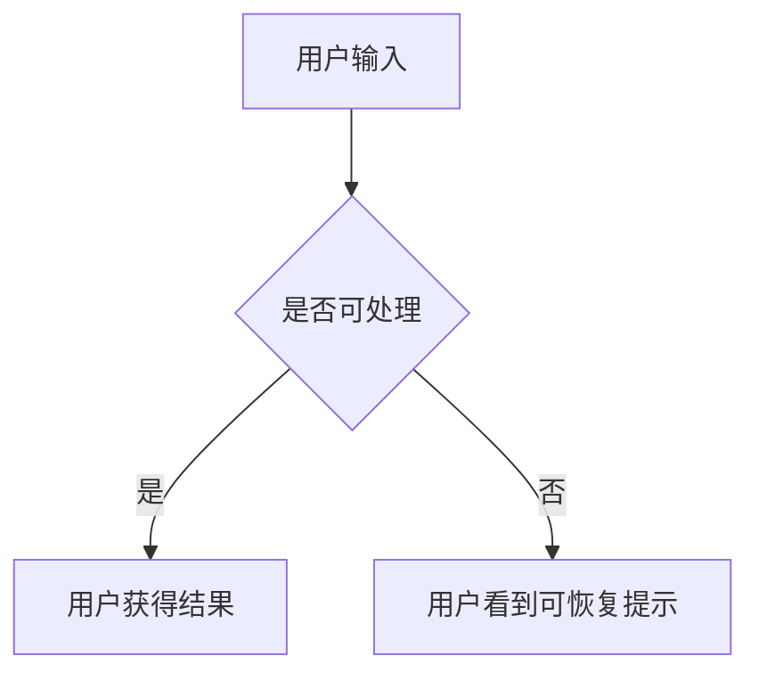
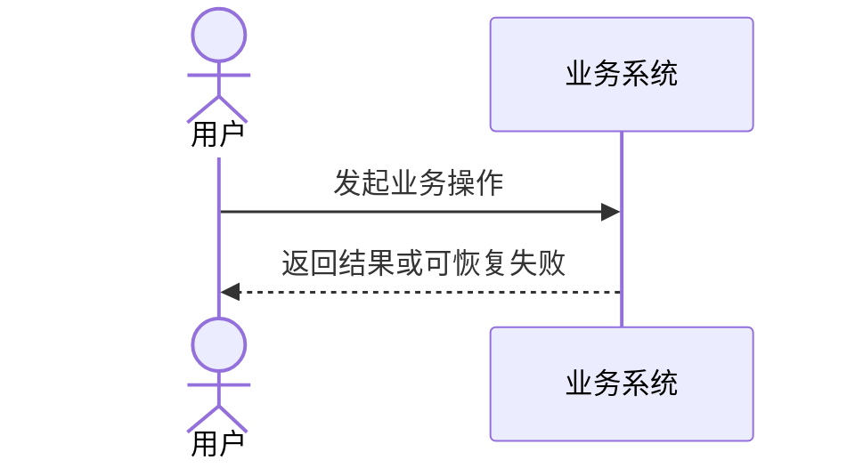

# PRD 模板（A 阶段工程基线）

> 保存工具会生成 `artifact_kind: prd`、`status: Draft`、`approval_verified: false` 和输入摘要；正文不要自带 front matter。

使用本模板时，将标题替换为实际项目名称。以下写作说明、占位内容和虚构示例用于指导整理，交付时删除或替换；不能把示例当作项目需求。保留现有必需的二级章节标题、REQ／AC 编号格式和两类业务图，按项目需要补充子节或其他章节。

以实际读取的需求、指定材料和用户选择为依据，标明事实、建议、假设与待决项。不适用的内容说明原因；没有依据的数字或结论保留未知，不为填满模板补造。需求尚未明确时可以交付 Draft，未决分支不写成已确认行为。本文的来源说明与业务变更说明使用自然语言，保存工具维护的状态、摘要等元数据不手填。

### 写作约定（交付时删除）

面向日常评审，产品与业务、研发与测试同等重要。前部让读者理解问题、目标、方案和取舍；REQ／AC 支持逐项核对业务行为与验收。默认形成满足本次评审用途的完整草稿，按业务复杂度展开，不规定最低字数或统一篇幅。

- 背景、原因和方案用连贯段落解释，比较、范围和追踪关系使用精简表格；不要把所有正文压成表格短句，也不要用长段落包办条件比较。
- 每节围绕其业务问题展开。有材料的部分说明具体内容及含义；缺少关键依据时说明缺什么、影响什么、怎样核实。无关子节或空表可删除，必需二级章节保留并简述适用情况，不机械铺陈“待确认”。
- 在重要事实、数字、范围选择或推断旁注明实际来源或状态，文末汇总便于追踪。用户明确的目标不等于已验证的收益，外部事实也不等于本项目决定采用。
- 继承已有回答与选择，仅对影响目标、范围、用户结果或关键验收的缺口定向澄清；其余未知可随 Draft 保留。建议说明理由及适用条件，得到确认前不写成确定规则。
- 概述负责摘要，案例走通过程，用户故事说明动机，REQ 集中维护业务规则，AC 定义验收。其他位置引用对应内容，避免多处维护相同规则。
- 使用明确、熟悉的业务语言，必要术语首次出现时解释。“准确、友好、快速、智能”等表达应结合可核对的行为或标准说明；没有依据的阈值保持未知。

## 项目概述

用一个简短段落交代：为谁解决什么问题、本次提供什么核心能力、用户流程如何改变，以及最重要的范围边界。再指出影响本次评审的关键未决选择（如有）。概述中的承诺须能在后文找到依据与对应需求，避免重复详细规则。

读者应能据此复述本次准备做什么、为什么做、做到哪里；具体问题依据和方案理由在下一节展开。

## 用户结果与成功指标

### 用户、现状与问题

用几段连贯正文说明谁在什么场景下完成什么任务、当前怎么做、问题发生在哪一步，以及对用户或业务的具体影响。涉及多角色时说明谁操作、谁受益、谁作决定。当前流程的存在本身不能证明它低效；有材料支持时说明问题的频率、规模或案例，没有则标明证据缺口及其影响。

交代本次需求的背景与交付用途、为什么现在处理、优先改善什么及其理由；只展开与本次评审相关的内容。问题描述与预设解决方式分清，重要结论就近引用实际材料章节、用户选择或其他可核对位置。

### 期望结果与方案概述

先说明完成后用户能够做什么、现状发生什么变化，再解释本次方案怎样回应上述问题：核心能力如何衔接，哪些环节由用户、其他角色或系统承担。方案概述让读者理解整体工作方式，详细规则在 REQ 中维护。

存在真实取舍时，简述已讨论的替代做法、采用当前方案的理由与代价，并标明是用户决定还是 Agent 建议。不强制增加竞品、市场规模或商业测算；已有资料不足以比较时说明限制。

### 成功指标与价值验证

区分已确认的用户目标与尚待验证的收益。逐项功能是否交付正确由 AC 验收；这里说明产品目标如何观察、预期价值如何验证。有量化依据时记录基线、目标、测量口径和来源；没有时写可观察结果及数据缺口，验证方式若为 Agent 提出则标为建议。

| 目标 | 指标或可观察结果 | 基线／目标及依据 | 验证方式 | 状态 |
| --- | --- | --- | --- | --- |
| 本次要改善的用户结果 | 用户能完成的操作或得到的结果 | 已知数据；无依据则待验证 | 指定案例、访谈或实际测量 | 已确认／建议／待确认 |

虚构写法示例：如果材料只明确“客服查资料后回复，期望 AI 提供建议、客服核对后发送”，应说明新能力作用于哪段流程、人工承担什么职责。“减少查找和组织答复的时间”是预期价值；缺少耗时基线时，不能写成“效率提升 50%”，可以提出用代表性问题对比处理时间的验证建议。此示例不构成本项目需求。

## 范围与边界

先简述本次交付的完整业务链路及其终点，再区分本次交付、明确不做、已讨论的后续想法与尚未决定。用户没有提及的功能不能自动列入本次，也不能直接写成已确认不做。范围表用于总览，具体条件和规则引用 REQ。

### 本次范围

| 能力／用户结果 | 适用角色和条件 | 业务边界 | 优先级及依据 | 对应 REQ |
| --- | --- | --- | --- | --- |
| 本次明确要交付的内容 | 人数、区域、业务对象等适用条件 | 包含到哪一步 | 已确认选择或明确标记的建议 | 对应编号 |

### 明确不做与后续想法

用简短列表分别列出已明确排除的能力及理由、已讨论的后续候选及本次暂缓原因，引用相关用户决定或材料。后续候选不代表交付承诺；尚未决定的范围进入待决事项。本节没有相关内容时简述实际情况，无需保留空表。

### 外部前置条件

| 外部条件 | 影响哪些用户结果 | 当前已知情况 | 不满足时的业务表现 | 待核实事项 |
| --- | --- | --- | --- | --- |
| 外部资料、服务能力或业务授权 | 对应 REQ／AC | 已验证／未核实 | 已确认的提示或处理；未定则说明 | 需要核对什么 |

这里只描述业务依赖及其影响。服务选型、接口字段、数据库、代码目录和任务拆分留到技术方案；未核实的外部能力不写成已经可用。

## 具体案例

`用户输入 → 系统处理 → 用户结果 → 失败后怎么办`

选择一个有代表性的正常案例，先交代角色、场景、输入样本、业务前提和预期结果，再按步骤走通操作与角色交接。案例应能让读者在不借助旧聊天的情况下理解过程。可用有序步骤或下表表达，不必同时重复两种形式。

| 步骤 | 角色／用户操作 | 系统的业务处理 | 用户看到的结果 | 依据／关联需求 |
| --- | --- | --- | --- | --- |
| 1 | 谁在什么条件下发起，提供什么 | 必要的信息核对 | 用户能确认的反馈 | 源需求章节；形成编号后关联 REQ |
| 2 | 用户或其他角色如何继续 | 核心业务处理与交接 | 对应的中间或最终结果 | 对应 REQ／AC |

用少量变体走查会改变用户结果的失败或退出路径，说明触发条件、可见结果和继续方式。区分已确认处理与待讨论处理，避免把未定分支写成固定行为；具体规则引用 REQ，验收引用 AC。

| 案例变体 | 触发条件 | 用户可观察的结果 | 下一步如何继续 | 状态／关联 AC |
| --- | --- | --- | --- | --- |
| 关键失败或退出 | 缺少输入、信息有歧义等实际条件 | 明确的提示、保留结果或退出状态 | 重试、修改、人工处理等已确认方式；未定则标记 | 已确认／待确认；对应 AC |

案例中的地点、角色、资料和其他样本须说明来自实际材料还是测试假设。案例用于验证流程，不自动扩展人数、城市、权限或其他范围。

## 用户故事

用“作为某类用户，在某个场景下，我希望完成某件事，以便获得某个结果”简述动机，并关联对应 REQ／AC 及必要的来源或未验证价值。按主要用户目标组织简短列表，不机械地为每个操作写一个故事。具体规则集中在 REQ，完整过程由案例说明。

虚构示例：“作为客服，收到员工问题后，我希望根据指定资料获得一份答复建议，以便核对后回复。”它不自动包含代发消息、知识库维护或历史记录。

## REQ 与 AC

每个 REQ 围绕一项可辨认的用户能力及稳定结果组织，先用一段话说明谁在什么场景下如何使用、获得什么结果，再展开相关业务规则。让缺少背景的研发与测试人员也能理解目的与核心逻辑；不要只写“支持处理”“正确展示”等概括词。

AC 使用“前置条件 → 操作 → 可观察结果 → 验证方式”，覆盖主成功路径及相关关键失败路径，数量按实际需要确定。规则、案例或 AC 暴露新选择时，标明缺口与影响；澄清后同步受影响内容，不能为写出完整验收而新增确定规则。需要性能、容量或体验阈值时记录依据，未知值进入待决事项。

REQ／AC 编号用于追踪，保持已有编号和含义，AC 编号全项目唯一；新增条目继续编号，不因改标题或调整顺序重编号。REQ 不代表开发 Feature 或前后端任务。可增加更多需求块，每个 AC 放在所属 REQ 下。

| 源需求章节／条目 | 对应 PRD 章节／REQ | 对应 AC | 转换说明／待补事项 |
| --- | --- | --- | --- |
| 实际读取的源内容；直接构建 PRD 时写本次材料依据 | 对应章节或编号 | 覆盖的验收编号 | 原结论、表达细化或仍待决定的内容 |

## REQ-001 能力名称

用一个简短段落描述本项能力的使用过程、用户结果和角色责任，必要时引用具体案例。

- 用户结果：本项能力使谁能完成什么，得到什么可辨认的结果。
- 适用角色与业务前置条件：使用者、权限及必要业务条件；无则说明。
- 输入与输出：说明输入的业务含义、必要内容，以及结果应包含什么、用户能据此做什么；不提前定义接口字段。
- 业务规则：按条件与结果逐条说明。根据相关性覆盖判断条件及不满足时的处理、角色交接与决定权、数据归属、状态变化及其对后续操作的影响、关键边界与例外。简单规则直接列出，多个条件组合复杂时可增加判断表；无需逐项填满所有提示。
- 优先级：已确认优先级与理由；Agent 建议明确标记。
- 来源与未决项：对应需求章节、用户选择或材料位置；未定行为在相关规则旁标记，并在这里引用待决事项，说明影响。

虚构规则写法示例：若已确认“只根据指定资料形成建议，资料不足时提示，由客服核对后发送”，应逐条说明结论须有资料支持、资料不支持回答时的表现、核对与发送责任。若部分问题有依据时如何处理尚未明确，应指出这一分支，不能自动决定部分回答或全部拒绝。

### AC-001 成功结果

- 结果类型：成功
- 前置条件：明确角色、输入和业务状态，给出可复用的验证样本或实际可取得的样本位置，说明样本与结果的对应关系。
- 操作：用户执行的具体动作。
- 可观察结果：用户看到或得到什么，必要时说明结果内容和状态。
- 验证方式：说明核对哪些结果、如何与输入或依据比较，避免仅写“人工检查”或“测试通过”；有数值要求时注明依据。

### AC-002 关键失败结果

- 结果类型：失败
- 前置条件：引发该失败的明确业务条件或样本。
- 操作：用户在该条件下执行的动作。
- 可观察结果：用户看到的提示、已得结果是否保留，以及下一步如何继续；尚未确认则标记。
- 验证方式：说明用于触发该条件的样本及检查内容，核对提示、结果和继续方式；未决行为只能记录为待补验收，不能据此宣称验收已明确。

虚构写法示例：若已确认“没有依据时明确说明且不编造答案”，可写“给定不含所问内容的指定测试资料，客服提交该问题后，看到缺少依据的提示，建议中不出现资料未支持的结论；逐项对照测试资料核验”。不得仅凭此示例采用对应产品规则。

## 业务流程图

用流程图表达入口、主流程、关键判断、角色交接和失败／退出去向。分支条件与用户结果须在文字和 AC 中有依据，图题或相邻说明关联 REQ／AC；未定分支标为待确认，不为补全图新增重试、审批或功能。图展示业务路径与分支，避免只把能力名称串成一条线；复杂且独立的流程可分图，不为每个操作机械画图。

以下只展示语法结构，交付时替换为本项目流程：

## 业务时序图

用业务时序图表达谁先做什么、向谁发起请求、何时获得结果，以及失败后如何继续。参与者先使用已确认的用户、业务角色和系统职责；接口、数据库、模型及具体服务的调用关系留到技术方案。图与流程图、REQ／AC 的角色和结果保持一致。

以下只展示语法结构，交付时替换为本项目业务交互：

## 风险与应对

记录会影响用户结果或本次交付的实际风险，说明触发条件、影响、已有应对和验证办法。风险尚未发生或尚未核实时保持相应状态；建议的应对措施不自动成为本次需求。外部依赖的事实放在“外部前置条件”，这里描述它可能带来的风险，避免重复维护。

| 风险／不确定性 | 触发条件 | 对用户或交付的影响 | 应对建议／已确认措施 | 验证或观察方式 | 状态／关联 REQ／AC |
| --- | --- | --- | --- | --- | --- |
| 有项目依据的风险 | 何时可能出现 | 影响什么结果 | 区分建议与用户决定 | 如何核实或发现 | 未验证／待决定／已采取；对应编号 |

按项目实际考虑输入质量、外部数据可用性、角色责任以及涉及的权限与数据使用边界。只有影响当前项目时才写，未知概率、损失、性能或成本不填造数值；技术风险与实现措施可作为待技术方案讨论项。

## 事实、假设与待决事项

区分已明确事实、外部证据、Agent 推断、建议和用户决定。重要结论与未知在相关正文旁说明，本节集中汇总来源、影响和处理状态，使用引用避免重复抄写。PRD 构建中出现的业务变化，注明是否已同步源需求；未同步时不声称两份文档完全一致。仅有保存或结构通过记录不能当作业务确认。

### 项目事实

简述实际采用的源需求文件与版本、指定材料及重要用户决定；缺少源需求时如实记录直接形成 PRD 的输入依据。用简短列表关联相关章节或 REQ，不重复汇总正文所有事实；有矛盾的材料说明冲突和当前采用理由，未解决的进入待决事项。

### 外部事实与来源

| 外部事实 | 直接来源／可核对位置 | 核对日期 | 限制与适用条件 | 本项目是否采用 |
| --- | --- | --- | --- | --- |
| 资料实际支持的结论 | 有实际依据才填写链接或位置 | 实际核对日期 | 未覆盖或尚未证实之处 | 区分事实与采用建议 |

### 假设

| 假设／建议 | 为什么提出 | 影响 | 验证或决定方式 | 状态 |
| --- | --- | --- | --- | --- |
| 尚未得到依据或确认的内容 | 已知理由 | 对应范围、结果或验收 | 需要什么依据或用户选择 | 未验证／未确认 |

### 待决事项

| 问题 | 选项与已有信息 | 影响的范围／REQ／AC | 当前建议 | 决定与源需求同步状态 |
| --- | --- | --- | --- | --- |
| 尚未明确的业务选择 | 不重复询问已有答案 | 说明是否阻塞当前交付 | 标为建议，可留空 | 待决定／已决定待同步／已同步 |

待决项应能支持讨论：问题说明到具体分支，已有选项写清影响和取舍，建议给出理由；信息不足时列明还需要什么依据，不强造选项。已知负责人或需要决定的时机可补充，不虚构人员或日期。

### 暂不影响当前用途

列出可以保留的未知及其不阻塞当前交付的原因，说明何时再处理；技术估算、服务选型等按职责留到技术方案，不为低风险细节反复中断需求整理。

## 变更摘要

以实际读取的上一版为比较依据，首版注明首次整理。说明替换、补充、范围变化及未决项变化，保留其他有效结论与稳定编号。

| 变更类型 | 本版变更 | 原因与依据 | 受影响的 REQ／AC／图 | 源需求同步状态 |
| --- | --- | --- | --- | --- |
| 首次整理／替换／补充／删除 | 本次实际变化 | 用户选择或材料变化 | 对应编号与章节 | 不涉及业务变更／待同步／已同步 |

### 本次评审重点

用简短列表指出本次需要决定的关键问题、最薄弱的证据或重要假设，以及它们影响哪些用户结果、范围或验收。引用正文和待决事项，按影响安排顺序；没有重要未决项时简述实际情况。保留实际保存与结构检查的状态，不把 Draft 写成正式确认。

<!--
交付前自查（写作指导，交付时删除；正文仅保留实际缺口与评审重点）：
1. 产品与业务：问题有何依据，方案如何回应，目标与价值假设是否分清，范围与取舍能否理解？
2. 研发与测试：输入输出、判断条件、角色责任和关键边界是否明确，案例能否走通，AC 的样本与结果能否核对？
3. 一致性：源需求是否遗漏或扩大，概述是否过度承诺，案例、REQ、AC 和两类图是否相符，引用编号与源需求同步状态是否准确？
4. 可读性：是否有重复规则、空表、占位或无关章节，重要结论的来源及未知是否出现在相关位置，评审者能否找到需要决定的问题？
结构检查只验证规定结构，不代表业务正确、图已渲染或正式确认。
-->
